

  

<h1 align="center">CA-VAL-AIM</h1>

  <b>Aim, movement and utility trainer for VALORANT players.</b> 
  It imports your VALORANT sensitivity, crosshair and keybinds, scales bots to your rank, 
  and tells you what is holding your aim back.

  
  
  

Windows 10/11 · free and open source · fan-made, not affiliated with Riot Games

<a href="#download">Download</a> · <a href="#screenshots">Screenshots</a> · <a href="#drills">Drills</a> · <a href="#routines-guide-and-glossary">Routines</a> · <a href="#aim-coach">Aim coach</a> · <a href="#how-it-works">How it works</a> · <a href="#building-from-source">Build</a>

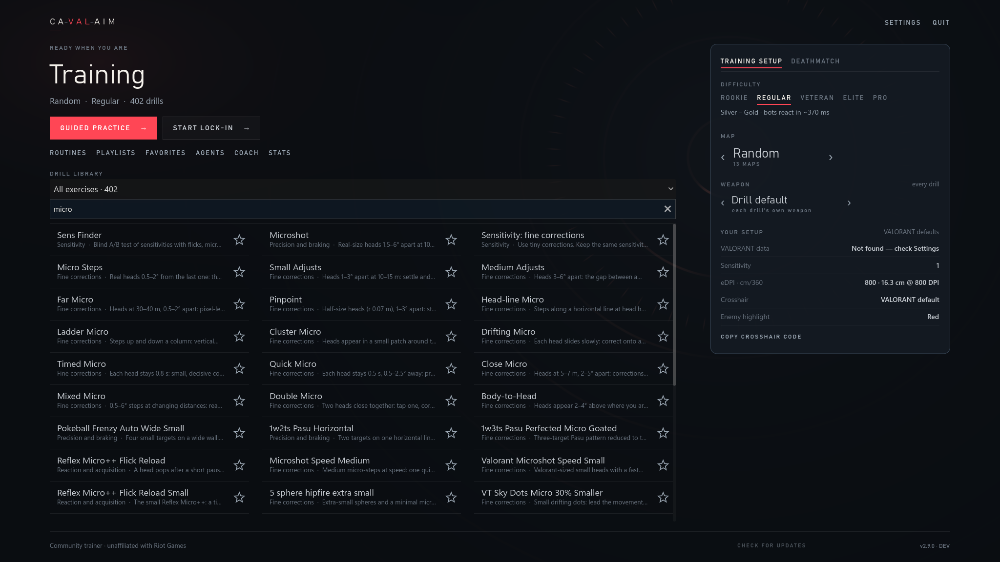

| **402 drills** | **13 maps** | **29 agents** | **8 skills** |
|:---:|:---:|:---:|:---:|
| Aim, reaction minigames, movement, utility and recoil | Real extracted geometry and minimaps | Signature, role, Lock-In and Voltaic routines | Ranked by a coach that explains the fix |

## Download

[**Get the latest release →**](https://github.com/Pyromesis/CA-VAL-AIM/releases/latest)

| File | What it does |
|---|---|
| `ValTraining-<version>-Setup.exe` | Installs CA-VAL-AIM for all users in `C:\Program Files\CA-VAL-AIM` (Windows asks for administrator permission), with Start-menu shortcuts and an uninstaller. The full map set is included. |

- **About 700 MB**, mostly the extracted map geometry. Windows 10/11, 64-bit; nothing else to install (.NET is bundled).
- Verify it against the release's `SHA256SUMS.txt`. The in-app updater verifies every download the same way.
- A portable copy is not published as a release download; build one with `tools/build-release.ps1` (see [CONTRIBUTING.md](CONTRIBUTING.md)).

| System | |
|---|---|
| **OS** | Windows 10 (1607+) or Windows 11, 64-bit |
| **GPU** | Vulkan or Direct3D 12 for full graphics; older GPUs, virtual machines and remote desktop switch to OpenGL / Direct3D 11 |
| **Disk** | About 3.3 GB with the full map set |
| **VALORANT** | Optional: without it, CA-VAL-AIM uses VALORANT's defaults and you set your sensitivity in Settings |

### Updates

CA-VAL-AIM updates itself. It checks at startup and every 6 hours, downloads in the background and installs only what matches the published hash.

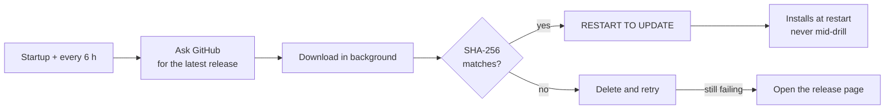

- **UPDATE NOW** downloads, verifies and restarts into the new version.
- **KEEP PLAYING** lets you train while it downloads: the window closes, the strip under the header shows the progress and offers the restart, and nothing is installed until you restart.
- **SKIP THIS VERSION** hides that release's prompt. The footer's **CHECK FOR UPDATES** control does the same on demand and turns into **RESTART TO UPDATE** once the file is verified.
- Settings, stats, maps and recordings are kept. Turn automatic checks off in Settings → About and the app only goes online when you ask.

<b>Why the release files still say ValTraining</b>

The app is called **CA-VAL-AIM**: window, menu, installer, shortcuts, executable (`CA-VAL-AIM.exe`), settings folder and source code. A few names stay on purpose:

| What | Name | Why |
|---|---|---|
| Release downloads | `ValTraining-<version>-Setup.exe` | Copies from 1.16.1–1.17.0 only recognise this prefix, so they can still update to CA-VAL-AIM. The new app accepts `CA-VAL-AIM-`, `ValTraining-` and `ValTrainer-` files. |
| Settings, stats, recordings | `%APPDATA%\CA-VAL-AIM` | New folder. The first start copies whatever a 2.3.0 or older copy kept in `%APPDATA%\ValTrainer`, so your data carries over. |
| Logs and shader cache | `%APPDATA%\Godot\app_userdata\CA-VAL-AIM` | New folder, for the same reason. |
| GitHub repository | `Pyromesis/CA-VAL-AIM` | Renamed with the app (it was `Pyromesis/ValTraining`). Old links redirect. 1.16.1–1.17.0 may show **OPEN DOWNLOAD** once, because GitHub rewrites download URLs after a rename. |
| Install folder | your existing folder | Updates install over the previous version, in the same folder and mode. New installs go to `C:\Program Files\CA-VAL-AIM`; `/CURRENTUSER` keeps a per-user copy in `%LOCALAPPDATA%\Programs`. |

## Screenshots

The English interface at 2048×1152. Select English or Spanish in Settings. Captures are in [`docs/screenshots`](docs/screenshots); the library search and favorites captures show v2.9.0; reaction captures show v2.8.0.

| | |
|---|---|
|  **Library search:** filter drills as you type and star the ones you want to keep. | 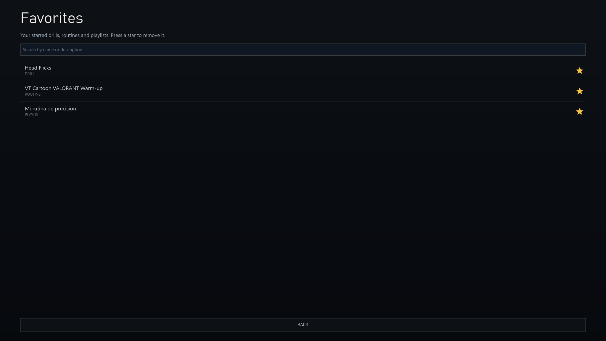 **Favorites:** saved tasks, routines and playlists together, with search. |
| 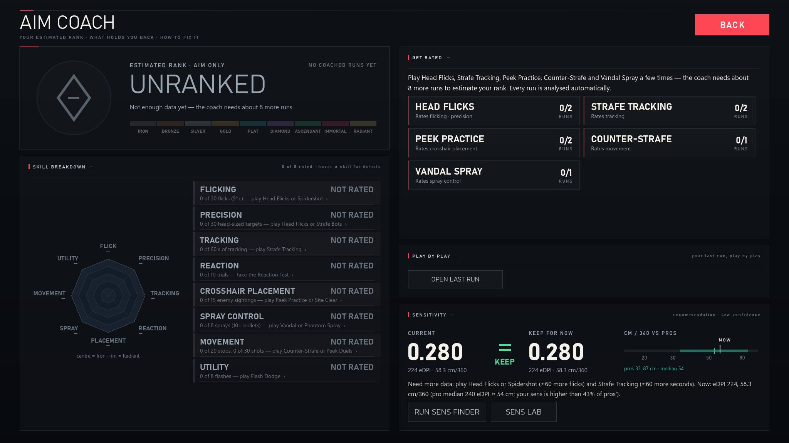 **Aim coach:** your estimated rank, the problems holding you back and the drill that fixes each one. | 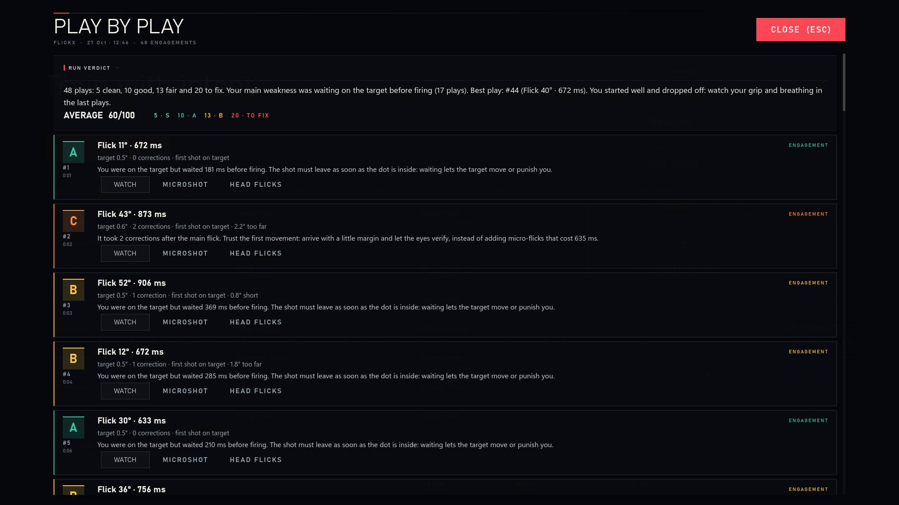 **Play-by-play:** every engagement graded on its own, with WATCH and PRACTISE. |
| 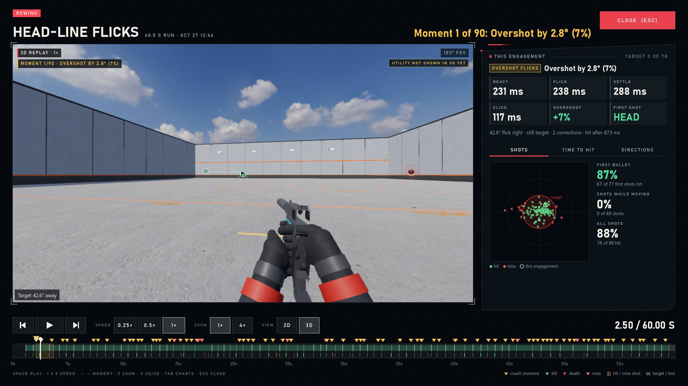 **Rewind:** the exact moment in 3D, with the crosshair path and the shot that followed. | 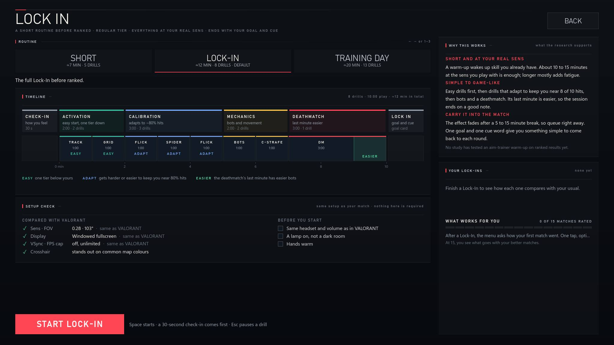 **Lock-In:** the guided warm-up that checks your setup before the first match. |
| 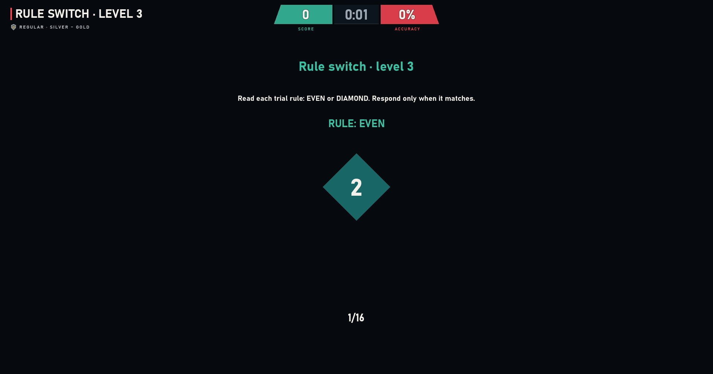 **Reaction without aiming:** read the current rule and respond or hold. | 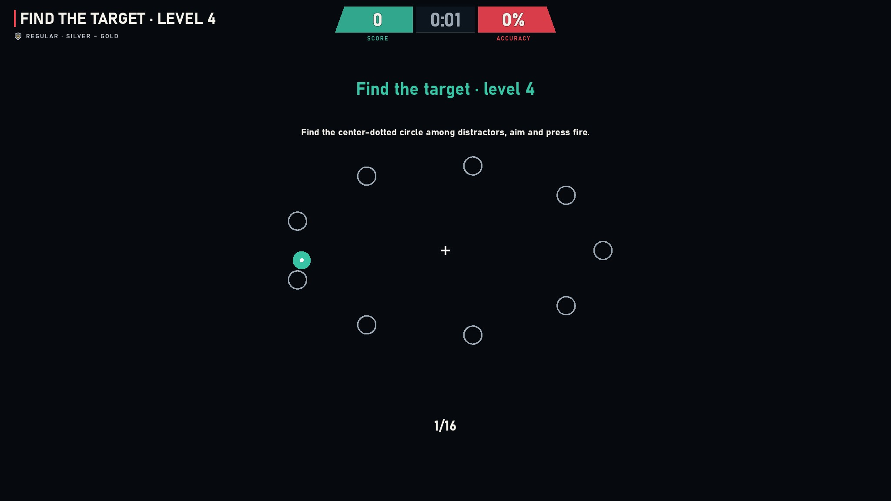 **Reaction with aiming:** find, acquire and confirm the target. |
| 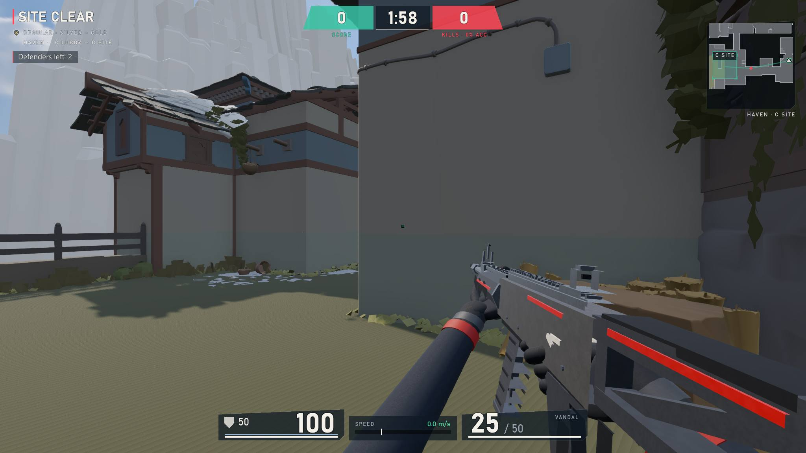 **Site Clear · Haven:** real angles, real cover and bots that hold them. | 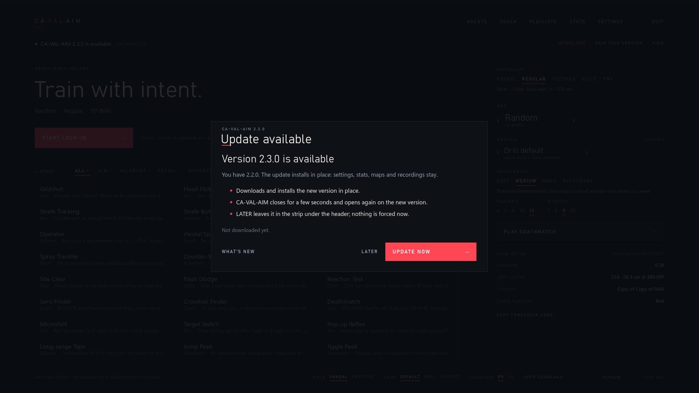 **Update window:** UPDATE NOW, or KEEP PLAYING while it downloads in the background. |

## What it copies from VALORANT

It reads `%LOCALAPPDATA%\VALORANT\Saved\Config` at every start and never changes it. It only reads those files: it never touches the game process, its memory or your input.

| | |
|---|---|
| **Aim** | Sensitivity, scoped and ADS multipliers, the same math as VALORANT (0.07° per count × sens) and 103° horizontal FOV. Raw mouse input keeps your cm/360 identical. |
| **Look** | The crosshair profile, drawn pixel-for-pixel with movement and firing error, and the enemy highlight colour. |
| **Controls** | All your keybinds (both slots; keys, mouse buttons and the wheel): movement, walk, crouch, jump, fire, alt fire, reload, plant / defuse and abilities; hold or toggle scope. |
| **Display** | Resolution, display mode, monitor, VSync and FPS cap. |

If several VALORANT accounts have played on the PC, pick one in Settings. Every value can be overridden there too.

## Drills

**402 library exercises across 11 sections**, plus the separate agent screen. This release adds 180 aim-training progressions and 50 reaction exercises (10 mechanics × 5 levels). Progressions change distance, target size, motion, timing or required contact—not just the name.

| Section | Exercises | Section | Exercises |
|---|---:|---|---:|
| Precision and braking | 88 | Precise tracking | 46 |
| Dynamic clicking | 20 | Reactive tracking | 20 |
| Fine corrections | 42 | Curved control | 20 |
| Sensitivity | 25 | Switch and confirm | 20 |
| Reaction and acquisition | 64 | Reaction minigames | 35 |
| Combat, movement and utility | 22 | | |

### Reaction games with and without aim

- **35 without aiming:** visual flashes, audio pulses, peripheral cues, shape-based inhibition, even-number decisions, memory matching and alternating rules.
- **15 with aiming:** pop-up targets, visual search among distractors and moving-target interception.
- Every game has **five levels and 16 trials**, with random waits, early-click penalties, errors and omissions. Aim games report movement onset separately from time to hit. Pausing restarts a pending trial so pause time does not inflate the measurement.
- The coach reviews every trial, saves its timeline and can prescribe an easier level of the same game. These games have their own measurements; memory, choice, audio and aim times are not ranked against simple visual reaction norms. Practising a task does not guarantee transfer to match performance.

| Category | What is in it |
|---|---|
| **Aim** | Gridshot, Head Flicks, Spidershot, Strafe Tracking, Air Tracking, Reactive Tracking, Microshot, Target Switch, Pop-up Reflex |
| **Flick · Tracking · Micro · Reflex** | 15 drills each (60 in all): distances, sizes, speeds, timings and patterns for every aim skill |
| **VALORANT** | Strafe Bots, Peek Practice, Operator, Long-range Taps, Arsenal Range (every weapon's damage and time to kill) |
| **Recoil** | Vandal Spray, Phantom Spray, Spray Transfer |
| **Movement** | Counter-Strafe, Peek Duels, Jump Peek, Jiggle Peek |
| **Map** | Site Clear, Deathmatch (12-player free-for-all; Easy / Medium / Hard / Nightmare bots), Post-Plant, Retake, Site Anchor on all 13 maps |
| **Utility** | Flash Dodge (Phoenix, Breach, KAY/O, Skye, Yoru, Vyse, Gekko), Sound Lock |
| **Agents** | Signature and role drills for all 29 agents, plus an agent Lock-In |
| **Coach** | Sens Finder, Crosshair Finder |
| **Other** | Reaction Test, Reaction Lab (visual, audio, peripheral, choice and flick; per-category stats in Stats → REACTION TIMES), Lock-In |

**Playlists** chain any of these into a saved set and hand over from one drill's results to the next.

## Routines, guide and glossary

The **ROUTINES** screen adapts the VALORANT material published by **Voltaic** and **cartoon** to the drills above:

| Tab | What it has |
|---|---|
| **Routines** | Eleven routines: five playable adaptations (Voltaic Easy, Advanced Classic, VALORANT Advanced, bardOZ Advanced and cartoon's warm-up), two external Kovaak's playlists with copyable share codes, the in-game practice section and three category routines (Recoil, Deathmatch and Maps). Every step has how-to-play and why-it-matters text, its source scenario name and the sensitivity/recoil it needs. |
| **Guide** | cartoon's aim-training guide, summarised in English and Spanish. |
| **Glossary** | 126 Voltaic aim terms with short Spanish/English definitions and a search box. |
| **Data** | An Excel-style table of every routine, step, term and your saved progress, with a four-file CSV export. |
| **Credits** | Full attribution, source links and the legal notice. |

Star tasks, routines and playlists to keep them together on the **Favorites** screen. Search the library, routines, favorites or playlist drill picker by name and description; search ignores case and accents and works with partial words. Favorites are stored locally in `favorites.json`.

Playable routines can be saved as normal playlists and edited like any other. The HUD shows the current task and repetition; its clock follows the actual run duration. For example, Cartoon’s three-minute tasks contain three one-minute runs before advancing. While paused, **‹ ›** jumps to the
previous or next task without saving the abandoned run. The trainer applies a source's sensitivity boost only on the
steps that ask for it, keeps it above 15 cm/360 (1.5× cap when your normal sens is already faster than 35 cm/360) and
keeps boosted runs out of your personal bests. Recoil, deathmatch and map drills always use a real magazine and camera
climb, because they simulate a match. Only the external Kovaak's playlists stay outside CA-VAL-AIM: the screen gives
you their share code.

The routines are **adaptations, not the original scenarios**, and CA-VAL-AIM is not affiliated with or endorsed by
Voltaic, cartoon, Aim Lab or Kovaak's. Original scenario names and share codes remain their authors' property; the
adapted text is GPL-3.0-or-later. Official links: [Voltaic](https://voltaic.gg/) ·
[Voltaic Discord](https://discord.gg/voltaic) · [cartoon](https://twitter.com/cartoonFPS). See
[CaValAim/CREDITS.md](CaValAim/CREDITS.md) for the complete list.

## Maps

**Ascent · Bind · Breeze · Fracture · Haven · Icebox · Lotus · Pearl · Split · Sunset · Summit · Abyss · Corrode**

The release includes the real extracted geometry and collision of **all 13 maps, complete** (every site, mid and both spawns), in the game's orientation and colours, plus the official minimaps calibrated to the 3D maps and used in the picker, the countdown briefing and the in-game minimap. Without the optional `maps/` folder the app falls back to blockouts; Breeze, Haven, Icebox and Split keep true-scale ones.

The map mechanics that matter are live too: **Lotus**' stone door turns 180° in 10 seconds from the button on either face (with its solid stone, pass-through window and grinding noise) and its A Site rope ascender lifts you to A Top; **Bind**'s Hookah window can be jumped and **Split**'s A Back wall stops bullets.

## Difficulty tiers (calibrated to ranks)

| Tier | Ranks | Bot reaction | Median time to kill you in the open |
|---|---|---|---|
| **Rookie** | Iron–Bronze | 480 ms | ≈4.4 s |
| **Regular** | Silver–Gold | 370 ms | ≈2.4 s |
| **Veteran** | Plat–Diamond | 290 ms | ≈1.4 s |
| **Elite** | Ascendant–Immortal | 225 ms | ≈0.84 s |
| **Pro** | Radiant | 180 ms | ≈0.53 s |

Bots react with a human-like delay, move their crosshair with Fitts' law and fire the Vandal with a per-shot hit chance against your 100 HP + 50 shield. Target sizes, speeds and time limits scale with the tier, and personal bests are tracked per tier. **Progressive difficulty** (pause menu) raises or lowers the tier after a strong or poor run and says so on the results screen.

## Weapons and movement

| | Vandal | Phantom |
|---|---|---|
| Fire rate | 9.75 rounds/s | 11 rounds/s |
| Magazine | 25 | 30 |
| Measured spray | 9.0° climb, 5.0° sweep | 7.5° climb, 4.5° sweep |
| Extra | Spread grows; recovery starts about 0.375 s after a tap and lengthens with the spray | Damage falloff |

- **Switch rifles** in Settings, or press *Equip primary* (1) during a countdown; every rifle drill follows your choice.
- **Slots 1 / 2 / 3** draw the big weapon, the sidearm and the knife with your VALORANT binds, and each keeps its magazine.
- **Any weapon, any drill:** the **WEAPON** picker in the menu and the pause menu remembers your choice. Weapon-specific drills (Vandal / Phantom Spray, Spray Transfer, Operator, Arsenal, Chamber and Crosshair Finder) keep their own rules.
- **Movement:** running adds 6° of spread and walking 3°; you are accurate below 27.5% of run speed, which is what makes counter-strafing work. Braking matches Riot's measured Phantom stop times.
- **Operator:** 2.5× scope, bolt action.

The Vandal and Phantom patterns are measured from the real sprays ([SprayTrace](https://spraytrace.fyi/patterns/valorant/vandal), [Phantom](https://spraytrace.fyi/patterns/valorant/phantom)); the rest of the arsenal is reconstructed, as Riot never published those numbers.

## Graphics and training aids

- Forward+ rendering with PBR materials and a different look per map, HDRI skies, sun shadows, AgX tonemapping, ambient occlusion and glow.
- Animated enemy agents with VALORANT-style outlines and red fresnel that walls hide, plus a first-person gloved viewmodel with recoil, sway, reload and bolt cycle.
- Muzzle flash, tracers, bullet-hole decals and per-agent flash effects.
- **Guide line** (Settings → Gameplay, on by default): a dashed line to the nearest target with the flick distance in degrees (an edge arrow when it is behind you), and a floor route to the nearest enemy on map drills. Off / Line / Line + Route.
- Picks a preset for your PC on first start (Low on integrated, virtual or software GPUs); change it any time in Settings.

## Aim coach

Completed runs record mouse input, crosshair path, shots and events to `%APPDATA%\CA-VAL-AIM\telemetry`. Telemetry and coaching archives remain locally until you remove them; free play saves each completed cycle. The coach turns them into:

| | |
|---|---|
| **Rank and skills** | An estimated rank overall and for 8 skills (flicking, precision, tracking, reaction, crosshair placement, spray, movement, utility), each with a confidence level. |
| **Play-by-play** | Every engagement graded on reaction, flick, settle, click, overshoot and first shot, with a verdict, what went wrong and the drill that fixes it. **WATCH** opens it in Rewind; **PRACTISE** launches the drill. There is no play cap: long runs page through every card. |
| **Second by second** | A one-second timeline built from the real telemetry: score bars, aim error, time on target, accuracy, movement, dead time, best and worst seconds and the weakest five-second stretch, with a paged table and **WATCH** at that exact moment. |
| **Problems** | Sorted by importance, each with your numbers, why it happens, how to fix it and drills to practise. |
| **Direction and tremor** | Separates left, right, up and down flicks, flags aim tremor, under- and overshooting, and points to a drill for each. |
| **Live coach** | Background analysis stores observations for review. Task instructions appear during the opening countdown; tutorial and coaching cards stay off the active play area. |
| **Run review** | The results screen adds a summary of that run, the top problems with fixes and what went well. |
| **Independent observations** | A play can retain overshoot, undershoot, corrections and delayed response together. Moving targets are excluded from static sensitivity braking judgments. |
| **Guided practice** | Instructions before each task, feedback afterward, and reproducible personal drill variants generated from diagnosis and severity. Save a plan as a playlist and reopen it later. |
| **Local neural forecasts** | Predicts next-run accuracy from comparable exercise, map, weapon, tier and sensitivity records. Requires at least 24 eligible rounds and must beat a moving average on held-out runs before a prediction is shown. Exercise prescriptions use diagnostic rules; the network is not a language model. |
| **Trends and plan** | Whether each skill is improving or dropping, plus one suggested drill per top problem. |
| **Sens Finder** | A blind A/B test of about 15 minutes (flicks, micro-adjustments and tracking), ending with a recommended VALORANT sens, eDPI and cm/360 and a button to use it in CA-VAL-AIM. VALORANT itself is never changed. |
| **Target order** | In Gridshot, checks whether you go for the target nearest your crosshair. |

The ratings need data: play Head Flicks, Strafe Tracking, Peek Practice, Counter-Strafe and Vandal Spray a few times each.

## How it works

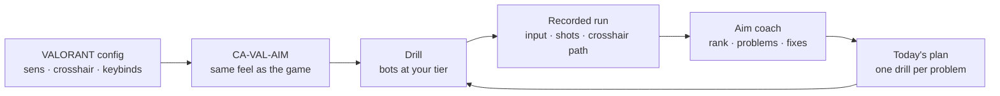

Startup, screens, the drill library and session loop, the aim and weapon model, bots, the coach, Lock-In, agents, maps, the data files, updates and the release pipeline are documented with **20 diagrams** in [docs/ARCHITECTURE.md](docs/ARCHITECTURE.md).

## Privacy

- **Nothing is uploaded on its own.** No account, no analytics, no telemetry leaves your PC.
- Settings, stats and recordings stay in `%APPDATA%\CA-VAL-AIM`. Delete that folder to reset everything.
- The only traffic is the update check to `api.github.com` and the download of a new release. Turn updates off in Settings → About and CA-VAL-AIM never goes online on its own.
- This build has no in-game bug-report relay and no Discord integration. Use the [GitHub issue tracker](https://github.com/Pyromesis/CA-VAL-AIM/issues) for bugs and feature requests.

## Troubleshooting

- **The game won't start or the screen stays black:** open **CA-VAL-AIM (safe graphics)** from the Start menu, or run `CA-VAL-AIM.exe --rendering-method gl_compatibility` (`ValTrainer.exe` on 1.17.0 and older).
- In compatibility mode the **first start can freeze for up to about 30 s** while shaders compile; later starts are fast.
- **Where things are:** settings and stats in `%APPDATA%\CA-VAL-AIM`; logs in `%APPDATA%\Godot\app_userdata\CA-VAL-AIM\logs`. Settings → About opens both and copies your system info.
- A damaged settings or stats file is kept as `*.corrupt` and the app starts fresh.
- Numbers use `.` in settings, stats and exports; Spanish sentences use the decimal comma.
- Still stuck? [Open an issue](https://github.com/Pyromesis/CA-VAL-AIM/issues/new/choose) and attach `godot.log`.

## Building from source

CA-VAL-AIM uses **Godot 4.7.2 .NET** and the **.NET 8 SDK**. [CONTRIBUTING.md](CONTRIBUTING.md) covers building, running, testing, the dev flags, the project layout and the release process.

The `maps/` folder (2.3 GB) is not tracked in Git. Every release ships all 13 extracted maps; the release workflow takes them from the `maps` pre-release (`maps.zip`). `tools/build-release.ps1` and `installer/CA-VAL-AIM.iss` stop if a map is missing, so a release can never go out without them. An install without the folder falls back to the blockout maps.

## License, credits and legal

Copyright (C) 2026 Pyromesis and contributors.

CA-VAL-AIM is free software: you can redistribute it and/or modify it under the terms of the **GNU General Public License, version 3 or (at your option) any later version** (SPDX: `GPL-3.0-or-later`). See [LICENSE](LICENSE). It is distributed in the hope that it will be useful, but without any warranty.

CA-VAL-AIM (formerly ValTraining) is a modified version of **ValTrainer** ([idoraz1/ValTrainer](https://github.com/idoraz1/ValTrainer)), copyright (C) 2026 ValTrainer contributors, also under GPL-3.0-or-later. The original copyright notice and GPL terms are preserved in [NOTICE](NOTICE), which the installer ships as `NOTICE.txt`; the modified source is this repository.

All 3D models, textures, skies and recorded sounds are CC0 (public domain), except the official VALORANT map minimaps and the optional extracted map geometry in `maps/` (© Riot Games, not CC0; see [CaValAim/CREDITS.md](CaValAim/CREDITS.md)). The Godot Engine and the bundled .NET runtime are MIT-licensed. CC0 and MIT are compatible with the GPL; the installer includes all notices in `THIRD-PARTY-NOTICES.txt`.

The community routines, guide summaries and glossary definitions are original paraphrases/adaptations of public documents by Voltaic and cartoon, distributed under GPL-3.0-or-later with attribution; see [CaValAim/CREDITS.md](CaValAim/CREDITS.md). They do not imply any endorsement by Voltaic, cartoon, Aim Lab or Kovaak's. CA-VAL-AIM is fan-made and is not endorsed by or affiliated with Riot Games, Voltaic, cartoon, Aim Lab or Kovaak's. VALORANT and its agent and map names are trademarks of Riot Games, Inc.; Aim Lab and Kovaak's are trademarks of their respective owners.

### Local flash audio

The `assets/audio/flash/originals` sound set uses original VALORANT Wwise events for Phoenix, Breach, KAY/O, Skye, Yoru, Vyse and Gekko/Dizzy, with source provenance and attribution in CREDITS.md. Original events take priority over synthesized fallbacks. To use separately obtained WAV clips, place them in `audio/flash/` inside the app data directory and restart the trainer. Names match cue identities, for example `phoenix_pop.wav`, `breach_pop.wav`, `kayo_pop.wav`, `skye_pop.wav`, `yoru_pop.wav` and `vyse_pop.wav`. Throw, flight and windup have separate `<agent>_throw.wav`, `<agent>_flight.wav` and `<agent>_windup.wav` slots. Gekko uses `dizzy_form.wav`, `dizzy_active.wav`, `dizzy_spit.wav`, `dizzy_incoming.wav` and `dizzy_splat.wav` (plus throw, down and bubble). `flash_ring.wav` is the shared ringing effect. Clips must be valid WAV files, up to 16 MiB and 15 seconds, with any silence before/after the cue trimmed. Each loaded clip retains its recorded duration and replaces only its matching cue; missing or rejected files keep the bundled sound. Local overrides are optional; the original sound set works without them.
