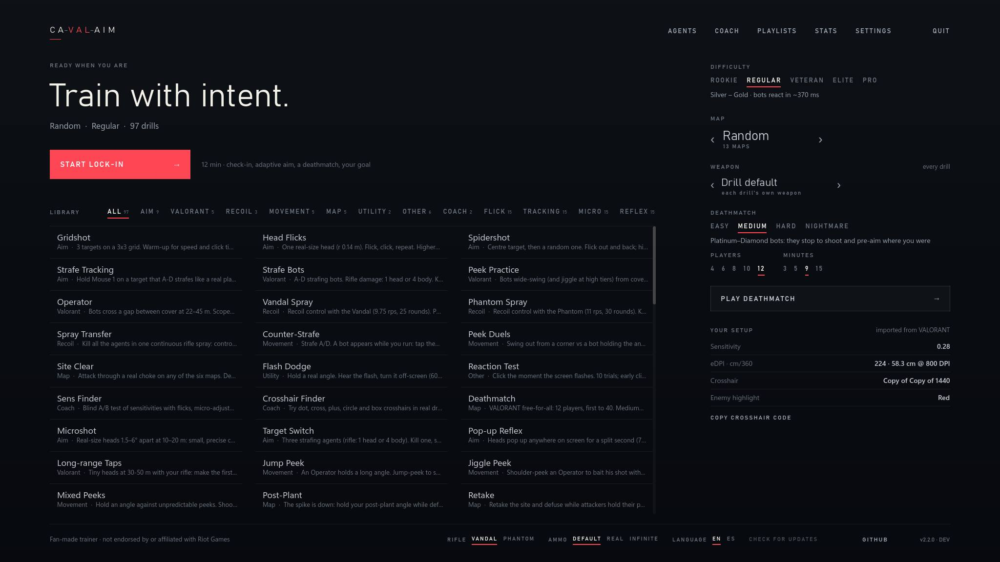
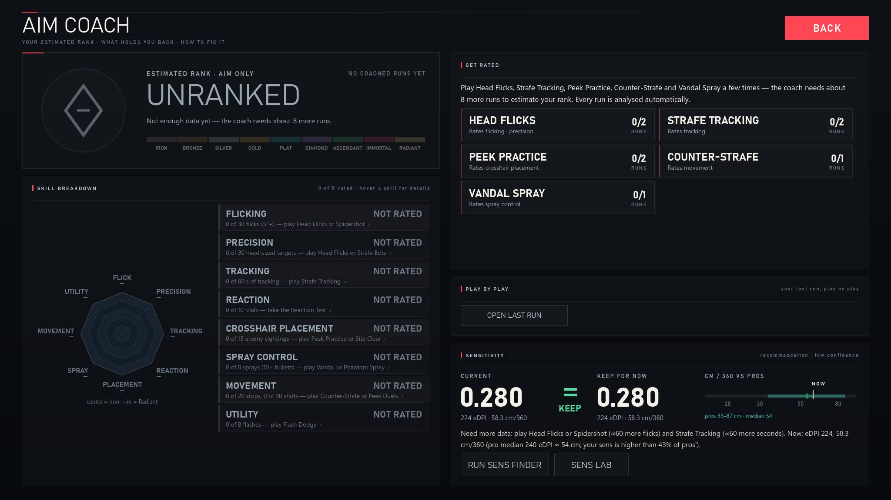
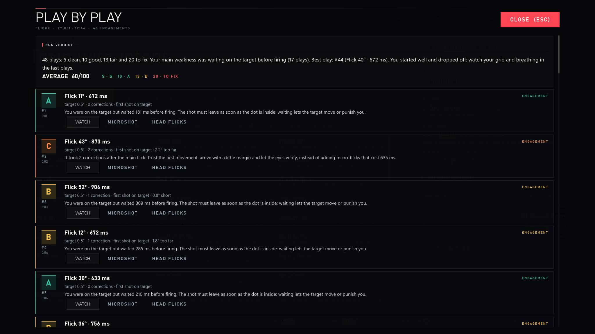
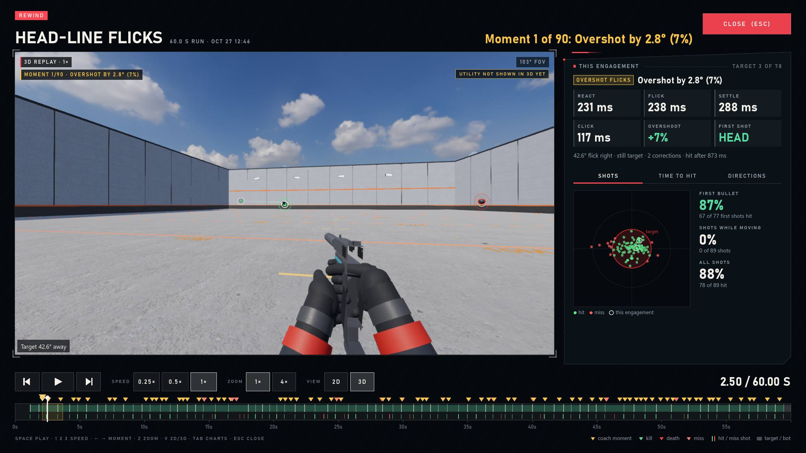
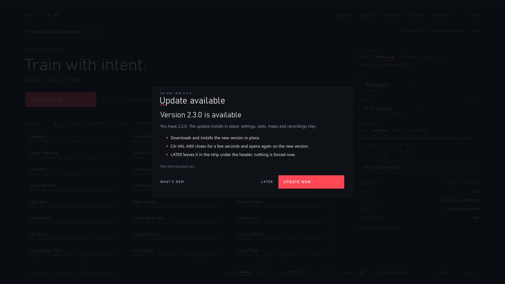
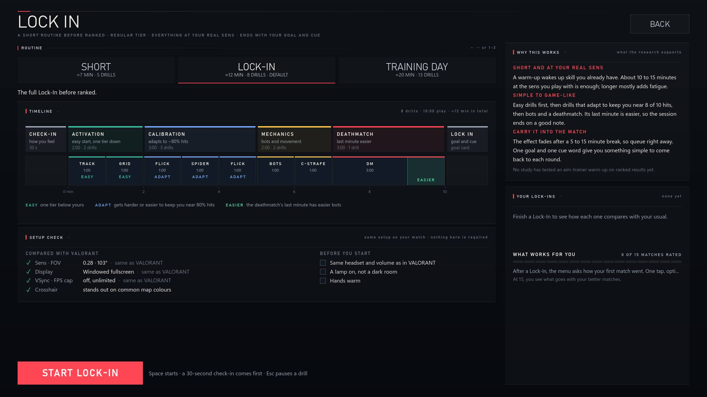
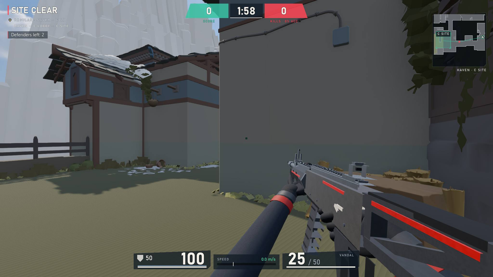
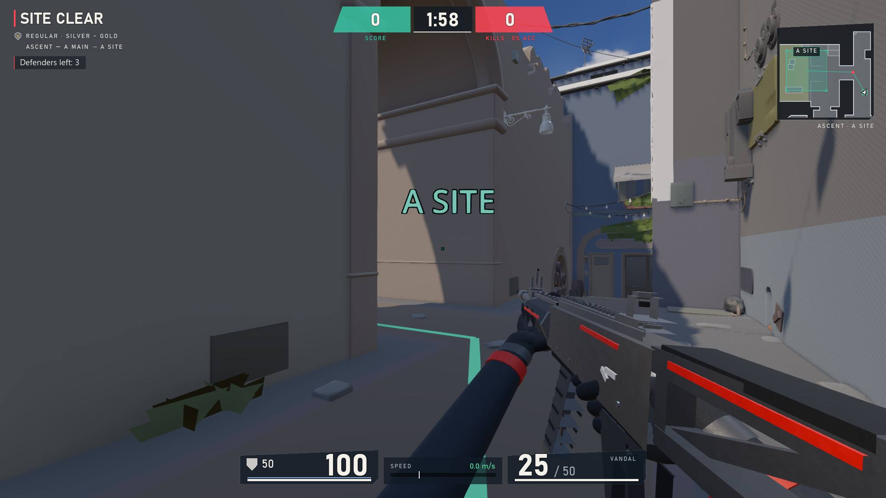

# CA-VAL-AIM

**A free aim, movement and utility trainer for VALORANT players.** CA-VAL-AIM imports your VALORANT sensitivity,
crosshair and keybinds, so every drill feels like the game. Bots and targets scale to your rank, and an aim coach
shows you what holds you back and how to fix it.

Windows 10/11 · free and open source · fan-made, not affiliated with Riot Games

## Download and install

Get the latest version from **[GitHub Releases](https://github.com/Pyromesis/CA-VAL-AIM/releases/latest)**:

| File | For |
|---|---|
| `ValTraining-<version>-Setup.exe` | **The one download.** Installs for all users in `C:\Program Files\CA-VAL-AIM` (Windows asks for administrator permission), with Start menu shortcuts and an uninstaller. Includes the full map set. |

The release also carries an `SHA256SUMS.txt` with the installer's SHA-256; the in-app updater verifies every download
against it. The installer is large (about 700 MB) because it bundles the optional extracted map geometry in `maps/`. The
Git repository does not contain those binaries; the app still runs without them and falls back to the blockout maps.
A portable (unzip-and-run) copy is no longer published as a release download, but you can still build one from this
repository with `tools/build-release.ps1` (see [CONTRIBUTING.md](CONTRIBUTING.md)).

### New name: CA-VAL-AIM (formerly ValTraining)

From 1.18.0 the app is called **CA-VAL-AIM**: window, menu, installer, Start menu shortcuts and the executable
(`CA-VAL-AIM.exe`). Nothing you have is lost, and some names stay on purpose:

| What | Name | Why |
|---|---|---|
| Release downloads | `ValTraining-<version>-Setup.exe` | ValTraining 1.16.1–1.17.0 only recognise release files with this prefix; keeping it lets those copies update themselves to CA-VAL-AIM. The new app accepts `CA-VAL-AIM-`, `ValTraining-` and `ValTrainer-` files. |
| Settings, stats, recordings | `%APPDATA%\ValTrainer` | Unchanged, so your data carries over. |
| Logs and shader cache | `%APPDATA%\Godot\app_userdata\ValTrainer` | Unchanged, so the first start after the update doesn't recompile every shader. |
| GitHub repository | `Pyromesis/CA-VAL-AIM` | Renamed with the app (it was `Pyromesis/ValTraining`). GitHub redirects the old links, so bookmarks and issue links keep working. 1.16.1–1.17.0 may offer **OPEN DOWNLOAD** instead of an automatic update once, because GitHub rewrites release download URLs after a rename. |
| Install folder | your existing folder | An in-app update installs over the previous version, in the same folder and mode. New installs go to `C:\Program Files\CA-VAL-AIM` (all users); `/CURRENTUSER` keeps a per-user copy in `%LOCALAPPDATA%\Programs`. |

**Updates:** CA-VAL-AIM updates itself. At startup and every 6 hours it asks GitHub for the newest release. When one
exists, a window opens with **UPDATE NOW** and **LATER**: UPDATE NOW downloads it, verifies the SHA-256 and restarts
into the new version; LATER keeps a banner under the header and nothing is installed until you say so. Settings, stats,
maps and recordings are kept. A new release also appears in the always-visible **UPDATE** button, which checks and
downloads on demand and turns into **RESTART TO UPDATE** once verified against `SHA256SUMS.txt`. You can turn automatic
checks off in Settings → About; the app only contacts `api.github.com` and the release download URLs.

## Screenshots

The English interface at 2048×1152; the same screens switch to Spanish with the **EN / ES** footer toggle.

| | |
|---|---|
|  **Main menu:** drills, tier, map and Deathmatch lobby in one place. |  **Aim coach:** your estimated rank, the problems holding you back and the drill that fixes each one. |
|  **Play-by-play:** every engagement graded on its own, with WATCH and PRACTISE. |  **Rewind:** the exact moment in 3D, with the crosshair path and the shot that followed. |
|  **Update window:** a new release can't be missed; UPDATE NOW or LATER. |  **Lock-In:** the guided warm-up that checks your setup before the first match. |
|  **Site Clear · Haven:** real angles, real cover and bots that hold them. |  **Site Clear · Ascent:** the same drill on the full extracted map set. |

More screens in [`docs/screenshots`](docs/screenshots): Settings, Stats, Agents and Site Clear on Bind.

## System requirements

- Windows 10 (1607+) or Windows 11, 64-bit. Nothing else to install (.NET is bundled).
- Any GPU with a Vulkan or Direct3D 12 driver gets full graphics. Older GPUs, virtual machines and remote desktop switch
  automatically to a simpler OpenGL/Direct3D 11 mode.
- About 3.3 GB of disk space with the full map set (the installer, the installed app and the maps).
- VALORANT is optional: without it, CA-VAL-AIM uses VALORANT's defaults and you set your sensitivity in Settings.

## Maps

All 13 standard maps are selectable:

**Ascent · Bind · Breeze · Fracture · Haven · Icebox · Lotus · Pearl · Split · Sunset · Summit · Abyss · Corrode**

The release includes the real extracted geometry and collision of **all 13 maps, complete** (every site, mid and both
spawns), in the real game's orientation and colours. Breeze, Haven, Icebox and Split keep their true-scale blockouts
only as a fallback for installs without the `maps/` folder. The official minimaps, calibrated to the 3D maps, are used
in the picker, the countdown briefing and the in-game minimap.

## What it copies from VALORANT

CA-VAL-AIM reads `%LOCALAPPDATA%\VALORANT\Saved\Config` every time it starts.

- **Aim:** sensitivity, plus the scoped and ADS multipliers. It uses the same math as VALORANT: 0.07° per count × sens,
  with a 103° horizontal FOV. The mouse is read as raw input, so your cm/360 is identical.
- **Look:** the crosshair profile, drawn pixel-for-pixel with movement and firing error, and the enemy highlight colour.
- **Controls:** all your keybinds (both slots; keys, mouse buttons and the scroll wheel): movement, walk, crouch, jump,
  fire, alt fire, reload, plant / defuse and abilities; hold or toggle scope. The weapon hand is a CA-VAL-AIM setting.
- **Display:** resolution, display mode, monitor, VSync and FPS cap.

If several VALORANT accounts have played on the PC, you can pick one in Settings. You can override any of these settings
there too. CA-VAL-AIM only reads VALORANT's settings files; it never changes them and never touches the game process,
its memory or your input.

## Drills

| Category | Drills |
|---|---|
| Aim | Gridshot, Head Flicks, Spidershot, Strafe Tracking, **Air Tracking**, **Reactive Tracking**, Microshot, Target Switch, Pop-up Reflex |
| Flick · Tracking · Micro · Reflex | 15 drills each (60 in all): distances, sizes, speeds, timings and patterns for every aim skill |
| VALORANT | Strafe Bots, Peek Practice, Operator, Long-range Taps, **Arsenal Range** (every weapon's damage and time to kill) |
| Recoil | **Vandal Spray / Phantom Spray**, Spray Transfer |
| Movement | Counter-Strafe, Peek Duels, Jump Peek, Jiggle Peek |
| Map | Site Clear, **Deathmatch** (12-player free-for-all; Easy / Medium / Hard / Nightmare bots, set in the menu), Post-Plant, Retake, Site Anchor on all 13 maps |
| Utility | Flash Dodge (Phoenix, Breach, KAY/O, Skye, Yoru, Vyse, Gekko), Sound Lock |
| Agents | All 29 agents: signature drills, role drills and an agent Lock-In |
| Coach | Sens Finder, Crosshair Finder |
| Other | Reaction Test, **Reaction Lab** (visual, audio, peripheral, choice, flick; per-category stats in Stats → REACTION TIMES), **Lock-In**: a short pre-ranked routine with a check-in, adaptive aim drills, a deathmatch and a hand-off card |

**Playlists** (menu → PLAYLISTS) chain any of these drills into a saved set and play it back to back, handing over
from one drill's results to the next.

## Difficulty tiers (calibrated to ranks)

| Tier | Ranks | Bot reaction | Bot's median time to kill you in the open |
|---|---|---|---|
| Rookie | Iron–Bronze | 480 ms | ≈4.4 s |
| Regular | Silver–Gold | 370 ms | ≈2.4 s |
| Veteran | Plat–Diamond | 290 ms | ≈1.4 s |
| Elite | Ascendant–Immortal | 225 ms | ≈0.84 s |
| Pro | Radiant | 180 ms | ≈0.53 s |

Bots react with a human-like delay, move their crosshair with Fitts' law and fire the Vandal with a per-shot hit chance
against your 100 HP + 50 shield. Target sizes, speeds and time limits scale with the tier. Personal bests are tracked per
tier. With **Progressive difficulty** on in the pause menu, a strong scored run raises the tier and a poor one lowers it;
the results screen says when the tier moved.

## Weapons

- **Vandal:** full auto at 9.75 rounds/s, 25-round magazine. Its measured spray pattern climbs 9.0° and sweeps 5.0°
  across the magazine, with spread growing and recovery that starts at about 0.375 s after one tap and lengthens with
  the spray.
- **Phantom:** 11 rounds/s, 30-round magazine, damage falloff, and its measured pattern (7.5° climb, 4.5° sweep).
- **Switching rifles:** pick Vandal or Phantom in Settings, or press *Equip primary* (1) during a drill's countdown
  (any time in free play) to swap; every rifle drill uses your choice.
- **Weapon slots:** 1, 2 and 3 draw the big weapon, the sidearm and the knife with your VALORANT binds. The big weapon
  is the drill's gun (your primary rifle when the drill uses a pistol or the knife), the sidearm is the drill's own
  pistol or the Classic, and each slot keeps its magazine. Weapon-specific drills (Vandal / Phantom Spray, Spray
  Transfer, Operator, Arsenal, Chamber and Crosshair Finder) keep their own weapon rules.
- **Any weapon in any drill:** the **WEAPON** picker in the menu (and in the pause menu) gives every drill that accepts a
  gun any playable weapon, or keeps each drill's own; the choice is remembered.
- **Operator:** 2.5× scope, bolt action.
- **Movement:** running adds 6° of inaccuracy and walking 3°. You are accurate below 27.5% of run speed, which is what
  makes counter-strafing work.
- **Stop timings:** braking matches Riot's measured Phantom stop times.

The Vandal and Phantom patterns are measured from the real sprays
([SprayTrace](https://spraytrace.fyi/patterns/valorant/vandal), [Phantom](https://spraytrace.fyi/patterns/valorant/phantom));
the rest of the arsenal's per-bullet recoil numbers are reconstructed, as Riot never published them.

## Graphics

Real-time Godot Forward+ rendering:

- PBR materials with a different look per map.
- HDRI skies, sun shadows, AgX tonemapping, ambient occlusion and glow.
- Animated enemy agents with VALORANT-style outlines and red fresnel; walls hide both.
- A first-person viewmodel (gloved hands, recoil, sway, reload, bolt cycle) that never clips into walls.
- Muzzle flash, tracers, bullet-hole decals and per-agent flash effects.

On the first start CA-VAL-AIM picks a preset for your PC (Low on integrated, virtual or software GPUs). Change it any
time in Settings.

## Guide line

Settings → Gameplay → **Guide line** (on by default): while a drill runs, a dashed line goes from your crosshair to the
nearest target with the flick distance in degrees (an arrow on the screen edge when it is behind you), and on map drills
a ribbon on the floor shows the shortest walk to the nearest enemy while none is in sight. Off / Line / Line + Route.

## Aim coach

Every run records your mouse input, crosshair path, shots and events to `%APPDATA%\ValTrainer\telemetry` (the 80 most
recent runs are kept). The coach analyses them:

- **Coach screen:** an estimated rank overall and for 8 skills (flicking, precision/micro-adjust, tracking, reaction,
  crosshair placement, spray, movement, utility), each with a confidence level.
- **Play-by-play:** every engagement of the run is graded on its own (reaction, flick, settle, click, overshoot, first
  shot), with a verdict, what went wrong and the drill that fixes it; **WATCH** opens that moment in Rewind and
  **PRACTISE** launches the drill. Up to 48 plays are kept, worst first.
- **Problems** sorted by importance, each with your numbers, why it happens, how to fix it and drills to practise.
- **Direction, tremor and flick error:** it separates left, right, up and down flicks (hit rate, error and the side you
  miss), flags aim tremor, under- and overshooting and reaction time, and points to a drill for each.
- **Live coach:** during a run, short cues with the evidence and one fix (crosshair too low, shooting while moving,
  overshooting or stopping short, sprays too long…). Settings → Gameplay → Live coach.
- **Run review:** the results screen adds a short review of that run: a summary, the top problems with fixes and what
  went well.
- **Target order:** in Gridshot the coach checks whether you go for the target nearest your crosshair.
- **Trends and today's plan:** each skill shows whether it is improving or dropping, and the coach suggests one
  drill per top problem.
- **Sens Finder:** a blind A/B test of about 15 minutes with flicks, micro-adjustments and tracking (the micro-adjustments decide the fine steps). It narrows down to the sensitivity you score best with and ends
  with a recommended VALORANT sens, eDPI and cm/360, plus a button to use it in CA-VAL-AIM. VALORANT itself is never
  changed.

The ratings need data: play Head Flicks, Strafe Tracking, Peek Practice, Counter-Strafe and Vandal Spray a few times each.

## How it works

Startup, screens, the drill library and session loop, the aim and weapon model, bots, the coach, Lock-In, agents, maps,
the data files, updates and the release pipeline are documented with 20 diagrams in
**[docs/ARCHITECTURE.md](docs/ARCHITECTURE.md)**.

## Privacy

- **Nothing is uploaded on its own.** No account, no analytics, no telemetry leaves your PC.
- Settings, stats and run recordings stay in `%APPDATA%\ValTrainer`. Delete that folder to reset everything.
- The only network traffic is the update check to `api.github.com` (at startup and every 6 hours) and the download of a
  new release. Turn automatic updates off in Settings → About and CA-VAL-AIM never goes online on its own.
- This build has no in-app bug-report relay and no Discord integration. Use the
  [GitHub issue tracker](https://github.com/Pyromesis/CA-VAL-AIM/issues) for bugs and feature requests.

## Troubleshooting

- **The game won't start or the screen stays black:** use the Start menu shortcut **"CA-VAL-AIM (safe graphics)"**, or
  run `CA-VAL-AIM.exe --rendering-method gl_compatibility` or `CA-VAL-AIM.exe --rendering-driver d3d12` (`ValTrainer.exe` on
  1.17.0 and older).
- In compatibility mode the **first start can freeze for up to about 30 s** while shaders compile; later starts are fast.
- **Where things are:** settings and stats are in `%APPDATA%\ValTrainer`; logs are in
  `%APPDATA%\Godot\app_userdata\ValTrainer\logs`. Settings → About has buttons to open both and to copy your system info.
- A damaged settings or stats file is kept as `*.corrupt` and the app starts fresh.
- Numbers use "." as the decimal point in settings, stats files and exports. In Spanish, numbers written inside
  sentences (warm-up scores, measurements) use the comma.
- Still stuck? [Open a GitHub issue](https://github.com/Pyromesis/CA-VAL-AIM/issues/new/choose) and attach `godot.log`.

## Building from source

CA-VAL-AIM is built with the [Godot Engine](https://godotengine.org) 4.7 (.NET / C#). You need Godot 4.7.2 .NET and
the .NET 8 SDK. [CONTRIBUTING.md](CONTRIBUTING.md) explains how to build, run, test and export it, the dev flags, the
project layout and the release process.

The `maps/` folder is not tracked in Git: every release ships all 13 extracted maps, but the 2.3 GB of geometry lives
only on the release machine, in `dist-maps/maps` (see [`tools/mapgen/README.md`](tools/mapgen/README.md)).
`tools/build-release.ps1` copies it next to the exported executable and stops if any of the 13 maps is missing, and
`installer/ValTrainer.iss` refuses to compile without it, so a release can never go out without the maps. The Release
workflow takes the set from the `maps` pre-release (`maps.zip`). An install without them still works and falls back to
the traced blockout maps.

## License, credits and legal

Copyright (C) 2026 Pyromesis and contributors.

CA-VAL-AIM is free software: you can redistribute it and/or modify it under the terms of the **GNU General Public
License, version 3 or (at your option) any later version** (SPDX: `GPL-3.0-or-later`). See [LICENSE](LICENSE). It is
distributed in the hope that it will be useful, but without any warranty.

CA-VAL-AIM (formerly ValTraining) is a modified version of **ValTrainer**
([idoraz1/ValTrainer](https://github.com/idoraz1/ValTrainer)), copyright (C) 2026 ValTrainer contributors, also
under GPL-3.0-or-later. The original copyright notice and GPL terms are preserved in [NOTICE](NOTICE), which the
installer ships as `NOTICE.txt`; the modified source is this repository. ValTrainer's own source is available at
<https://github.com/idoraz1/ValTrainer>.

All 3D models, textures, skies and recorded sounds are CC0 (public domain), except the official VALORANT map minimaps
and the optional extracted map geometry in `maps/` (© Riot Games, not CC0; see
[`ValTrainerGodot/CREDITS.md`](ValTrainerGodot/CREDITS.md)). The Godot Engine and the bundled .NET runtime are
MIT-licensed. CC0 and MIT are compatible with the GPL; the installer includes its license notices in
`THIRD-PARTY-NOTICES.txt`.

CA-VAL-AIM is fan-made and is not endorsed by or affiliated with Riot Games. VALORANT and its agent and map names are
trademarks of Riot Games, Inc.
