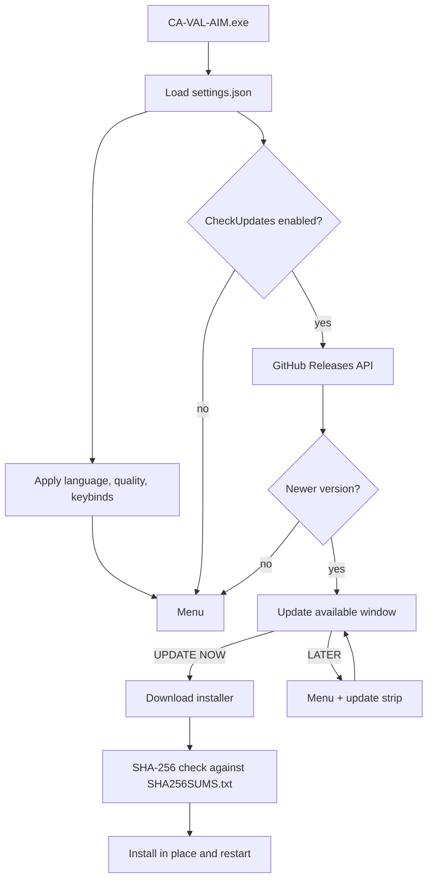
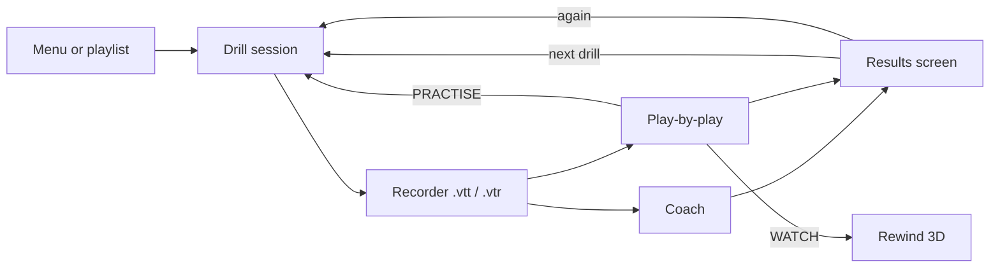
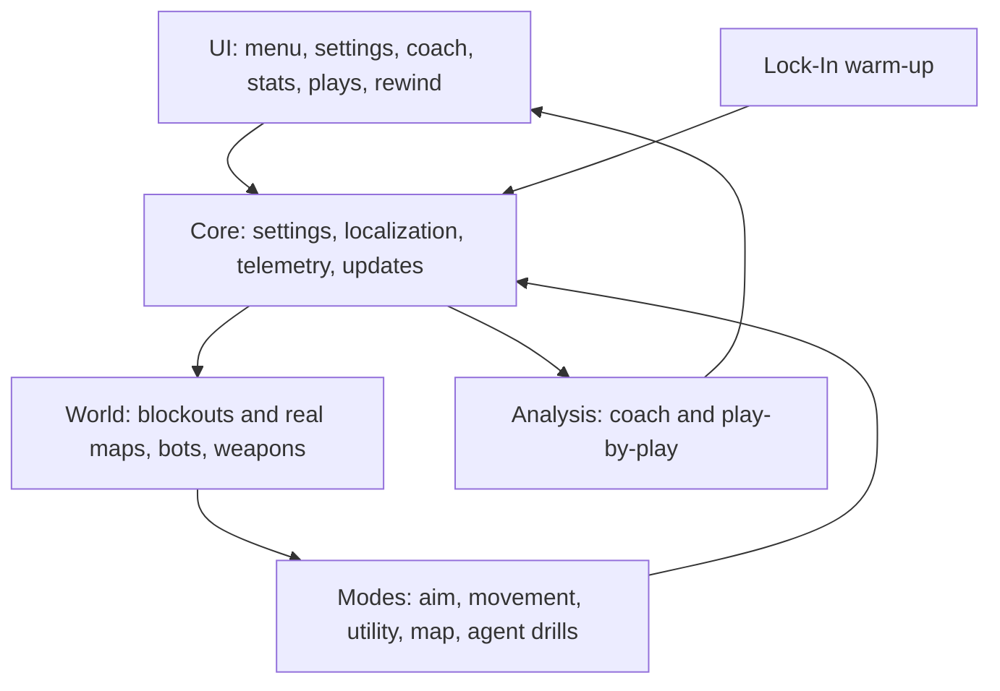
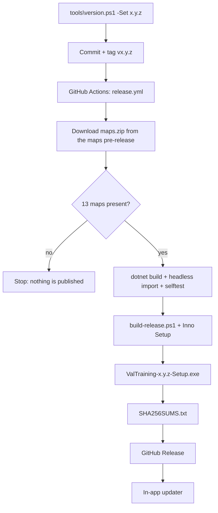

# How CA-VAL-AIM works

This document is the map of the codebase: what happens at startup, how a drill becomes a grade and a replay, and how
a release is built. The diagrams render on GitHub (Mermaid).

## Startup and updates

`Main.cs` loads the settings, applies the language and graphics quality, then opens the menu. The update check is
opt-in and never blocks the first frame: the answer arrives in the background, and the menu shows it as a window or
as the strip under the header.

Settings live in `%APPDATA%\ValTrainer\settings.json`; the update state (`LatestVersion`, `SkippedVersion`) is part of
the same file, so a release offered once and put off is not offered again as a pop-up in that session.

## A drill, from menu to coach

Every mode uses the same session skeleton: a `GameSession` owns the world, the HUD and the timer, the mode decides
what counts as a hit, and a recorder writes the run to `%APPDATA%\ValTrainer\telemetry` as a `.vtt` (frames, shots,
events) with an optional `.vtr` sidecar.

- **Coach** (`Analysis/Coach.cs`) aggregates runs and points at the weakness to train next: reaction, flick
  direction, overshoot, tremor, tracking, crosshair placement, utility timing.
- **Play-by-play** (`Analysis/PlayByPlay.cs`) grades each engagement on its own (reaction, settle, click, first shot)
  and keeps the worst 48; `UI/PlaysScreen.cs` draws the list and the WATCH / PRACTISE buttons.
- **Rewind** (`UI/RewindScreen.cs`, `RewindView3D.cs`) rebuilds the exact moment from the `.vtt` and draws the
  crosshair path and the shot that followed.

## Layers

`Loc.cs` is the single translation table (English and Spanish). Brand names (`CA-VAL-AIM`, `LOCK-IN`) are never
translated, and a sentence stays in English rather than appearing half-translated. Spanish prose uses the decimal
comma; settings, stats files and exports keep the dot.

## Maps and art

The 3D drills run on true-scale single-site blockouts. When the extracted map set is installed, `World/RealMap.cs`
loads the real geometry and `UI/MapArt.cs` uses the official minimap PNGs for the menu postcards and the HUD panel
(site wash, spawn, choke, player arrow). Without them the app falls back to the traced blockouts and palette
postcards, so a missing map never breaks a screen.

The 13 maps are not tracked in Git. Releases get them from the `maps` pre-release; the release workflow downloads the
archive, checks that all 13 are present and stops if any is missing.

## Release pipeline

The tag must match `config/version` in `ValTrainerGodot/project.godot`; the workflow checks it before building. The
installer is the only download: it contains the app, the .NET runtime and the full map set, installs for all users in
`C:\Program Files\CA-VAL-AIM`, and leaves settings and stats in `%APPDATA%\ValTrainer` untouched on upgrade.

## Where to look

| Concern | Files |
|---|---|
| Startup, window, screenshot/dev flags | `ValTrainerGodot/src/Main.cs` |
| Settings, language, stats paths | `ValTrainerGodot/src/Core/AppSettings.cs`, `Loc.cs` |
| Update check and update window | `ValTrainerGodot/src/Core/UpdateCheck.cs`, `UI/UpdatesPrompt.cs` |
| Drill loop and scoring | `ValTrainerGodot/src/Modes/*`, `TrainingMode.cs` |
| Coach and play-by-play | `ValTrainerGodot/src/Analysis/Coach.cs`, `PlayByPlay.cs` |
| Rewind | `ValTrainerGodot/src/UI/RewindScreen.cs`, `RewindView3D.cs` |
| Real maps and minimaps | `ValTrainerGodot/src/World/RealMap.cs`, `UI/MapArt.cs` |
| Build and release | `tools/build-release.ps1`, `installer/ValTrainer.iss`, `.github/workflows/release.yml` |
| Tests | `tools/selftest.ps1` |
