# How CA-VAL-AIM works

This is the map of the codebase: what starts, what talks to what, how a drill becomes a grade and a replay, how a
Lock-In is built, and how a release is published. The diagrams are Mermaid, so GitHub renders them; their boxes name
the real classes, files and screens in `ValTrainerGodot/src`.

**Contents**

1. [The system at a glance](#1-the-system-at-a-glance)
2. [Startup](#2-startup)
3. [Screens and navigation](#3-screens-and-navigation)
4. [The drill library](#4-the-drill-library)
5. [The life of a drill](#5-the-life-of-a-drill)
6. [Session state machine](#6-session-state-machine)
7. [Aim model](#7-aim-model)
8. [Weapons](#8-weapons)
9. [Bots and difficulty](#9-bots-and-difficulty)
10. [The coach](#10-the-coach)
11. [Play-by-play and Rewind](#11-play-by-play-and-rewind)
12. [LOCK-IN](#12-lock-in)
13. [Agents](#13-agents)
14. [Maps and art](#14-maps-and-art)
15. [Data on disk](#15-data-on-disk)
16. [Language and number formatting](#16-language-and-number-formatting)
17. [Updates](#17-updates)
18. [Release pipeline](#18-release-pipeline)
19. [Threads and the frame loop](#19-threads-and-the-frame-loop)
20. [Where to look](#20-where-to-look)

---

## 1. The system at a glance

CA-VAL-AIM is a self-contained Windows trainer. It reads VALORANT's own configuration (never writes it), runs drills in
a 3D world, records every run, and turns those recordings into coaching. The only network traffic is the update check
and the download of a new release.

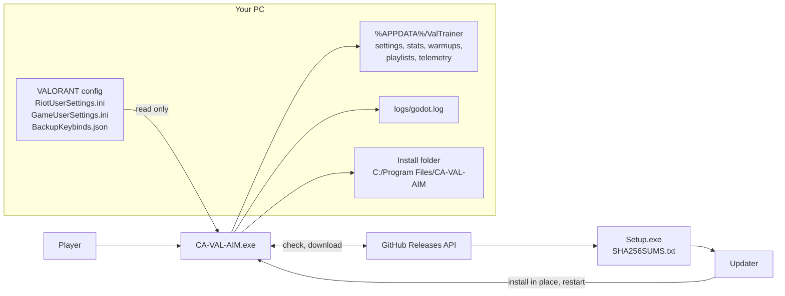

- **Nothing is uploaded.** Settings, stats and telemetry stay in `%APPDATA%\ValTrainer`.
- **VALORANT is untouched.** Its files are read to import sensitivity, crosshair, keybinds and display settings.
- **The map set is not in Git.** Releases carry the 13 maps and the installer is the single download.

---

## 2. Startup

`Main._Ready` is the whole boot sequence. It latches "do not save" before anything can write, claims the single
instance, imports VALORANT, applies the display and language, resumes or starts an update, and then picks the first
screen.

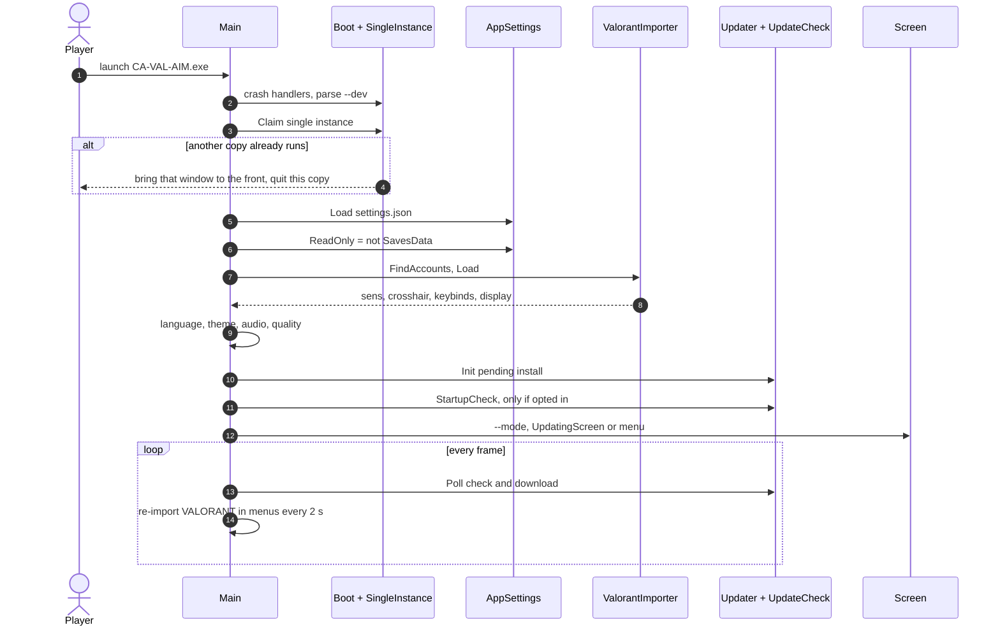

Notes that matter:

- **Read-only latch.** A dev run with `--data-dir` only writes when it also passes `--write-data`; the lock is taken
  before the first save, because importing a sensitivity can save settings.
- **Single instance.** A second launch signals the first one to come forward and quits without loading or saving
  anything (`Core/SingleInstance.cs`).
- **VALORANT polling.** While a menu is open, the game re-reads `RiotUserSettings.ini`, `GameUserSettings.ini` and
  `BackupKeybinds.json` when their timestamps change, so a sens or crosshair change in VALORANT appears in the trainer
  without a restart.
- **Updates never interrupt a drill.** A downloaded installer is applied on the next start, before the menu
  (`State.Ready` in `Core/Updater*.cs`).
- **Quality on first run.** No settings file means the first launch picks a preset from the GPU (`SysInfo.AutoQuality`):
  Low on integrated, virtual or software GPUs.

---

## 3. Screens and navigation

`Main.SetScreen` swaps one Godot node for another with a crossfade still; `Main.StartMode` goes through the loading
screen so the map's levels load with a progress bar. Screens are plain `Node` classes in `UI/`.

From the menu, everything is one hop away:

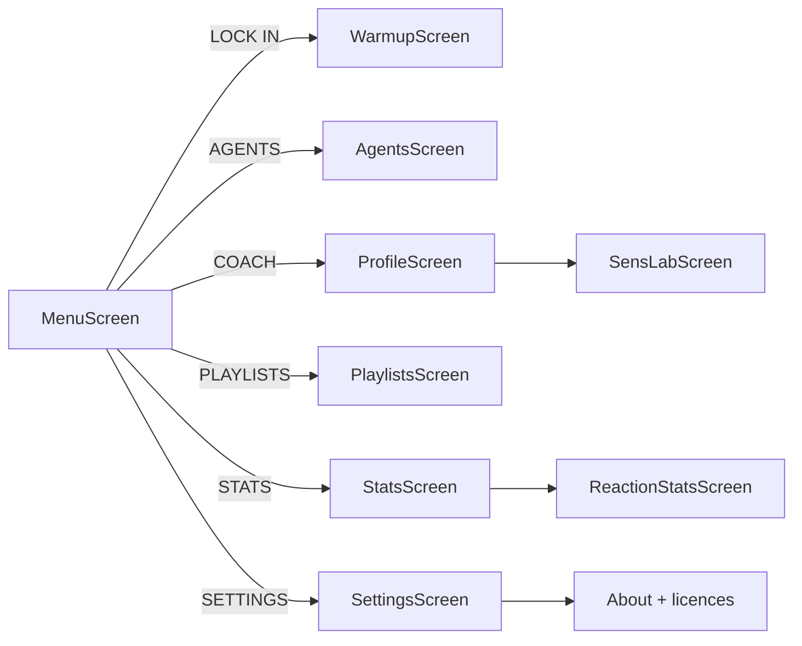

The drill path is a straight line, with the pause and results panels as side exits:

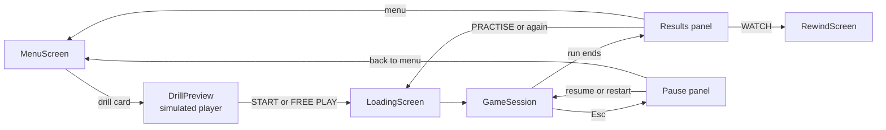

| Screen | What it does | Main file |
|---|---|---|
| `MenuScreen` | Library with category tabs, drill cards, Lock-In entry, links, update banner | `UI/MenuScreen.cs` |
| `DrillPreview` | Plays the drill with a simulated player before you commit | `UI/DrillPreview.cs` |
| `LoadingScreen` | Builds the world and loads map levels with a progress bar | `UI/LoadingScreen.cs` |
| `GameSession` | The drill itself: world, player, weapon, HUD, timer, results | `Game/GameSession.cs` |
| `ProfileScreen` | Estimated rank, 8 skills, problems, today's plan | `UI/ProfileScreen.cs` |
| `StatsScreen` | Personal bests and history per drill and tier | `UI/StatsScreen.cs` |
| `ReactionStatsScreen` | Reaction times by category | `UI/ReactionStatsScreen.cs` |
| `SensLabScreen` | Sensitivity evidence across runs | `UI/SensLabScreen.cs` |
| `AgentsScreen` | 29 agents, roles, abilities, drills and agent routines | `UI/AgentsScreen.cs` |
| `PlaylistsScreen` | Named sets of drills played back to back | `UI/PlaylistsScreen.cs` |
| `WarmupScreen` | Lock-In setup: preset, shifter, estimate | `Warmup/WarmupScreen.cs` |
| `RewindScreen` | 3D reconstruction of a run with the crosshair path | `UI/RewindScreen.cs` |
| `PlaysScreen` | The play-by-play list of a saved run | `UI/PlaysScreen.cs` |
| `UpdatingScreen` | "Updating CA-VAL-AIM" while the installer takes over | `UI/UpdatingScreen.cs` |

---

## 4. The drill library

`ModeRegistry.All` holds 42 factories and appends the 60 aim variants (`Modes/AimVariants.cs`), so the library has
**102 entries**. Keys can carry an argument (`flashpeek:skye`, `smokeexec:omen`), and an instance's key includes it, so
stats and personal bests stay per agent.

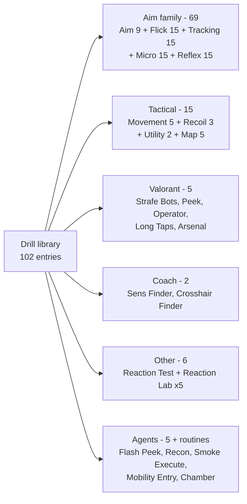

| Tab | Entries | What it trains |
|---|---|---|
| Aim | 9 | Gridshot, Flick, Spidershot, Tracking, Microshot, Target Switch, Popup, Air Tracking, Reactive Tracking |
| Flick | 15 | One motion to the target, on seven patterns: random, centre-out, horizontal, vertical, wide, cluster, ladder |
| Tracking | 15 | Keeping the crosshair on a moving target: strafe, orbit, bob, figure-8, zigzag, jump, wander, surge, approach |
| Micro | 15 | Small corrections on distant targets |
| Reflex | 15 | Short windows, one shot per target |
| Movement | 5 | Counter-Strafe, Peek Duel, Jump Peek, Jiggle Peek, Peek Mix |
| Recoil | 3 | Spray Control Vandal, Spray Control Phantom, Spray Transfer |
| Utility | 2 | Flash Dodge, Sound Lock |
| Map | 5 | Site Clear, Post Plant, Retake, Anchor, Deathmatch |
| Valorant | 5 | Strafe Bots, Peek, Operator, Long Taps, Arsenal |
| Coach | 2 | Sens Finder, Crosshair Finder |
| Other | 6 | Reaction Test and the five Reaction Lab categories |
| Agents | 5 + routines | Listed on the Agents screen, not in the menu library |

The menu builds its tabs from each drill's `Category`, so the tabs are exactly `ALL` plus the twelve above except
`Agents`. Deathmatch lives under **Map** because it inherits from `MapMode`; the per-agent drills are reached from the
Agents screen.

**Difficulty is data, not code.** Every drill asks `Difficulty` for its numbers (target radius, flick distance and
angle, lifetime, bot skill) at the run's tier, so the same drill scales from Rookie to Pro without a second
implementation.

---

## 5. The life of a drill

A run is a loop of input → movement → weapon → mode → telemetry. When the clock ends, the session builds a
`RunRecord`, asks the coach for a `RunReview`, saves stats and writes the telemetry.

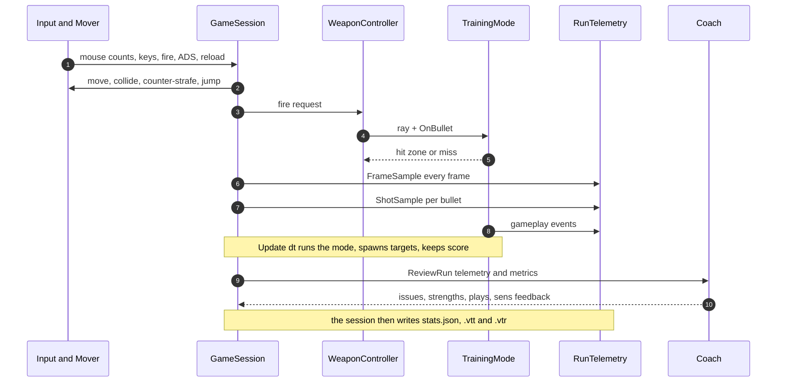

- **`GameSession` owns the run**: world, camera, player, weapon, HUD, timer and state. The mode only decides what a
  hit means, what to spawn and how to score.
- **Frame samples** hold angles, raw mouse counts, target offset and radius, speed and flags (firing, ADS, accurate,
  crouch, blind, alive, airborne).
- **Shots** hold the bullet direction, the zone it hit (head, body, legs or miss) and the error against the target
  centre.
- **Events** are the named facts the analysis needs: `target_spawn`, `target_hit`, `kill`, `bot_seen`, `stop`, `died`,
  `flash`, `spray_end`, `spray_residual`, `reaction`, `early_click`, `round_won`, `round_lost`, `jump`, `land`,
  `fall_damage`, `spot`, `coach_tip`.
- **Results** shows the mode's own lines, the coach review, the play-by-play and the personal best; `WATCH` opens
  Rewind at the exact second of a play and `PRACTISE` starts the drill that fixes it.

---

## 6. Session state machine

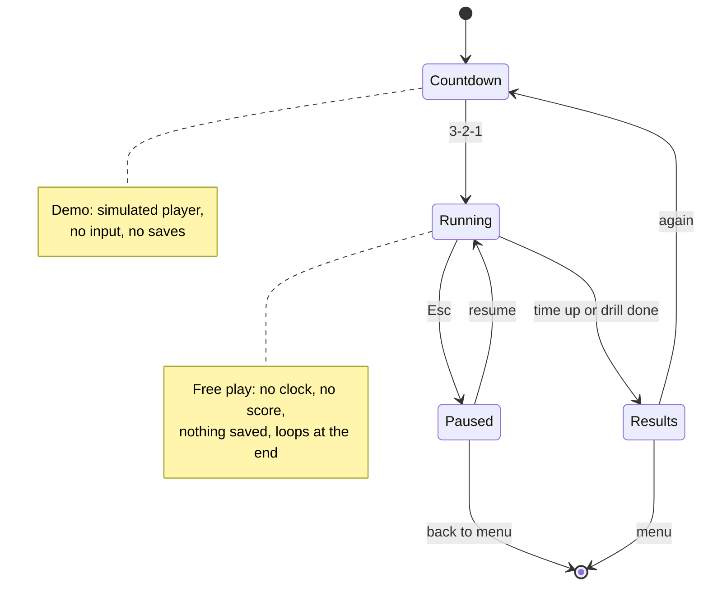

- **Free play** (`Main.StartMode(..., freePlay: true)`) drops the clock and the score, never writes stats, telemetry or
  Rewind, and restarts the drill when its time is up.
- **Demo** (`DrillPreview`) runs the same session with `Demo = true`: no mouse capture, no sound, no saves, and a
  simulated player (`SimAim`) plays the drill.

---

## 7. Aim model

The view uses VALORANT's own numbers: **0.07° of yaw per mouse count × sensitivity**, **103° horizontal FOV**, and
zoomed sensitivity scaled by the weapon's multiplier divided by its zoom.

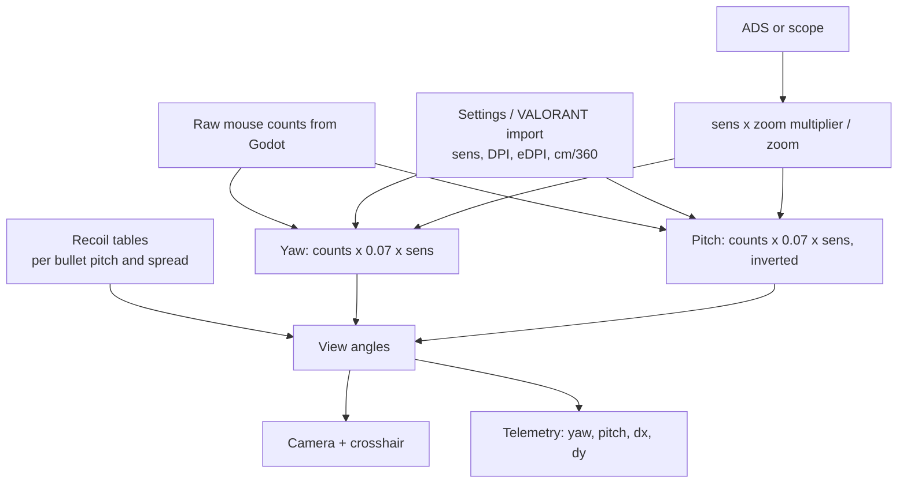

- Sensitivity is imported from VALORANT unless the player sets a custom one; a custom value that still equals the last
  import keeps following VALORANT.
- Settings and stats files always use the dot; Spanish prose uses the decimal comma. Parsing accepts both.
- `SensInput` accepts `0.35`, `0,35` and ` .4 `, clamps to VALORANT's range and rounds to three decimals.

---

## 8. Weapons

`WeaponController` models Riot's documented recoil system: full auto at the real fire rate, "heat" as a fractional
bullet index into the per-bullet recoil table, spread from per-bullet error plus movement, and the camera following the
recoil and drifting back as heat decays.

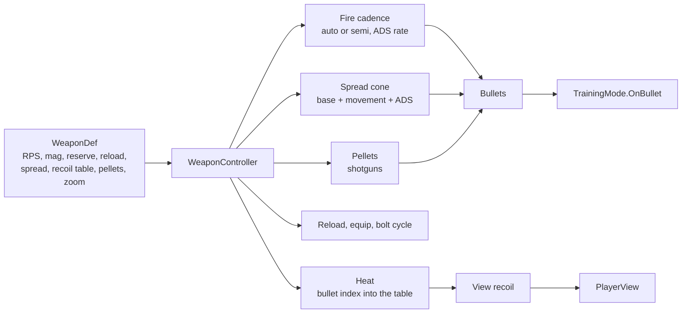

| Weapon | Used by | Notes |
|---|---|---|
| Vandal | Most rifle drills | 9.75 rps, 25 rounds, one-shot head at any range |
| Phantom | Rifle drills when selected | 11 rps, 30 rounds, faster and quieter |
| Sheriff | Pistol drills, Chamber's Headhunter | Semi-auto, high first-shot accuracy |
| Operator | Operator and angle drills | Bolt action, scope, heavy movement penalty |
| Headhunter / Tour de Force | Chamber drills | Ability weapons with their own cadence |
| The rest of the arsenal | Modelled in `Core/Weapons.cs` | Damage, fire rate, spread and falloff from Riot's numbers |

Drills that accept either rifle follow **Settings → Primary rifle**, and a weapon picked in the pause menu overrides it
for that run. Some drills keep their own weapon (Spray Control always runs Vandal or Phantom).

---

## 9. Bots and difficulty

Bots are `BotCharacter` puppets driven by `BotBrain`: perception, a sampled reaction time, a Fitts-law aim settle, a
burst rhythm and a hit chance. `BotNav` builds a path over the level's solid boxes.

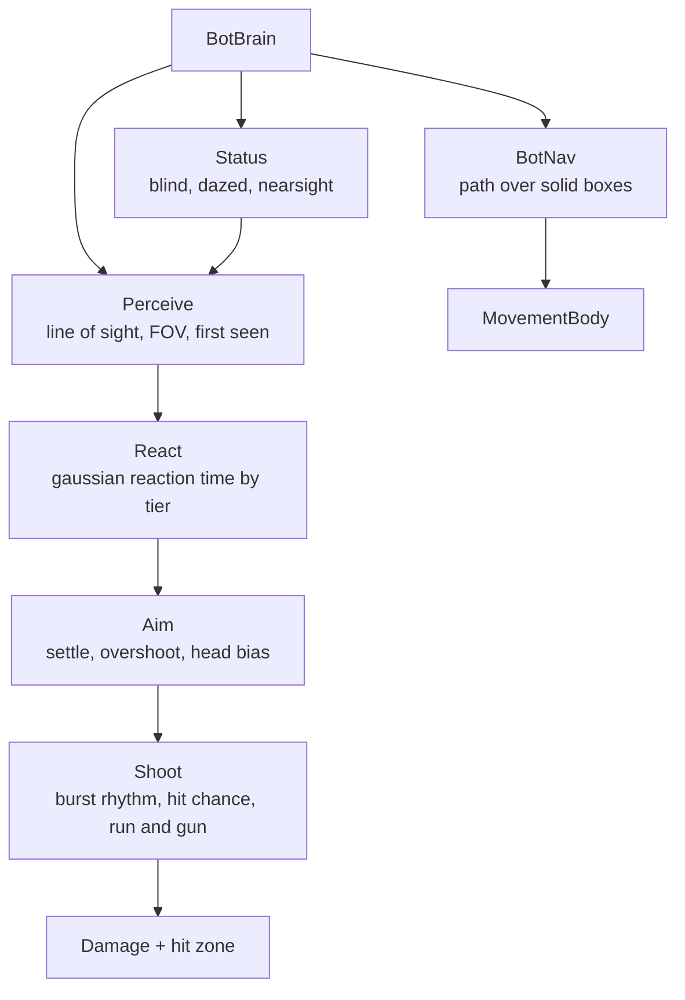

| Tier | Rank band | Reaction (median) | Simulated time to kill |
|---|---|---|---|
| 0 Rookie | Iron – Bronze | 480 ms | 4.4 s |
| 1 Regular | Silver – Gold | 370 ms | 2.4 s |
| 2 Veteran | Platinum – Diamond | 290 ms | 1.4 s |
| 3 Elite | Ascendant – Immortal | 225 ms | 0.84 s |
| 4 Pro | Radiant | 180 ms | 0.53 s |

- **Adaptive drills** (`Staircase`) move a continuous level around a target hit rate (usually 80%), so difficulty
  follows the player within a run instead of jumping between tiers.
- **Deathmatch** has its own lobby settings (difficulty, 4–12 players, 9 minutes) and eases the bots in the last minute
  of a Lock-In finisher (`Difficulty.EasedBot`).
- **Progressive difficulty** can move the saved tier up after a strong run and down after a poor one.

---

## 10. The coach

Everything the coach knows comes from the telemetry of real runs. `RunAnalysis` turns frames, shots and events into
metrics; `Bench` compares them with the tier; `Assess` finds problems; `Coach` builds the profile and the plan.

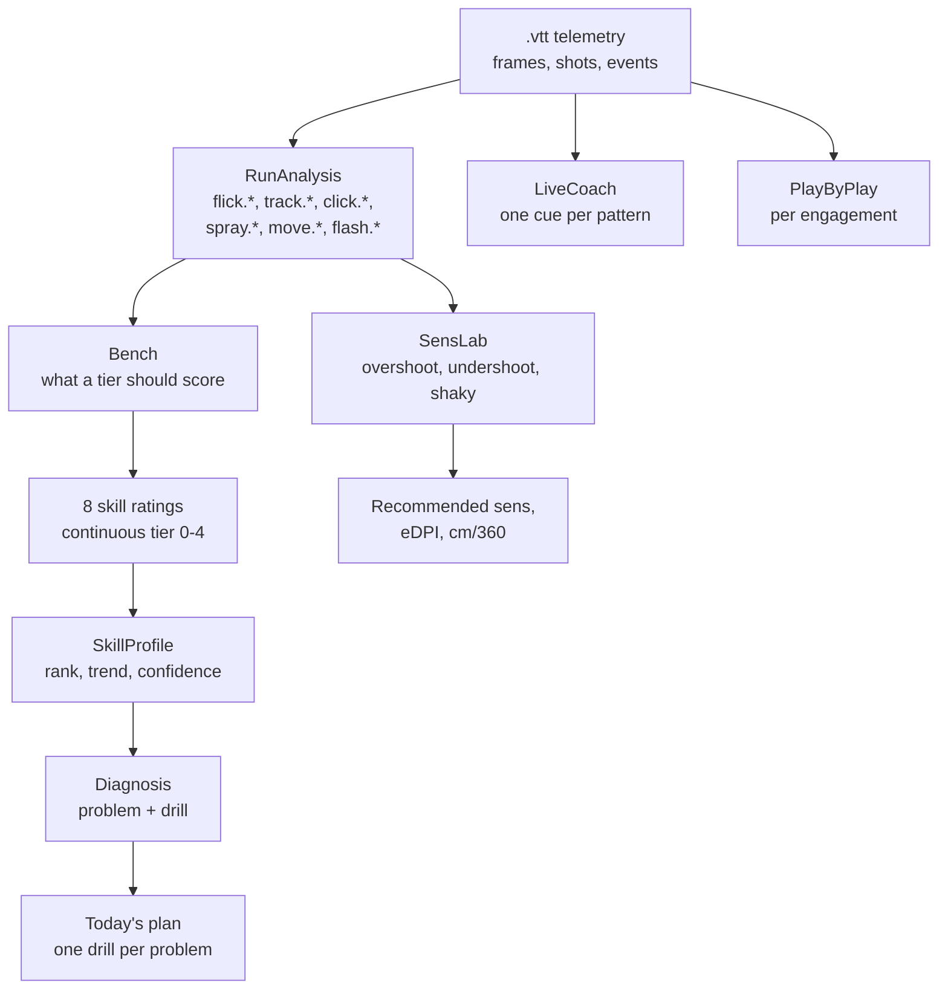

The eight skills are **Flicking, Precision, Tracking, Reaction, Crosshair placement, Spray control, Movement and
Utility**. Each rating carries a confidence and a sample count, so a skill with two runs is not treated like one with
forty.

- **Metrics are grouped by prefix**: `flick.*` (amplitude, time to target, overshoot, undershoot, curvature,
  anticipation, first-shot error), `track.*` (time on target, jitter, lag), `click.*` (click timing against the settle),
  `spray.*` (residual after the burst), `move.*` (counter-strafe stops, speed at the shot), `flash.*` (dodge rate, turn
  time).
- **Live coach** (`Analysis/LiveCoach.cs`) reads the last ~12 seconds every second and shows at most one short cue with
  its evidence and a concrete fix; each kind waits 25 s before repeating and two cues are at least 7 s apart. Every cue
  is logged as `coach_tip` and listed on the results screen.
- **Sens Lab** aggregates runs by sensitivity and classifies the pattern (overshoot, undershoot, shaky, tracking-limited,
  mixed) before recommending a change.
- **Sens Finder** is the in-drill version: a blind PSA-style bisection in log space, four blocks per step, head flicks
  plus seeded strafe tracking, standardized within the step and compared with Welch's standard error.
- **Crosshair Finder** ranks colour and outline candidates by computed contrast against the map palettes and the enemy
  highlight, tests the best few with a detection task, then brackets shapes with real Vandal drills and hands the
  winner over as a VALORANT crosshair code. VALORANT itself is never changed.

---

## 11. Play-by-play and Rewind

`PlayByPlay.Analyze` cuts a run into engagements and grades each one on reaction, flick, settle, click, overshoot and
first shot. The worst 48 are kept, worst first. Each play carries a verdict, what went wrong, the drill that fixes it
and its time window in the recording.

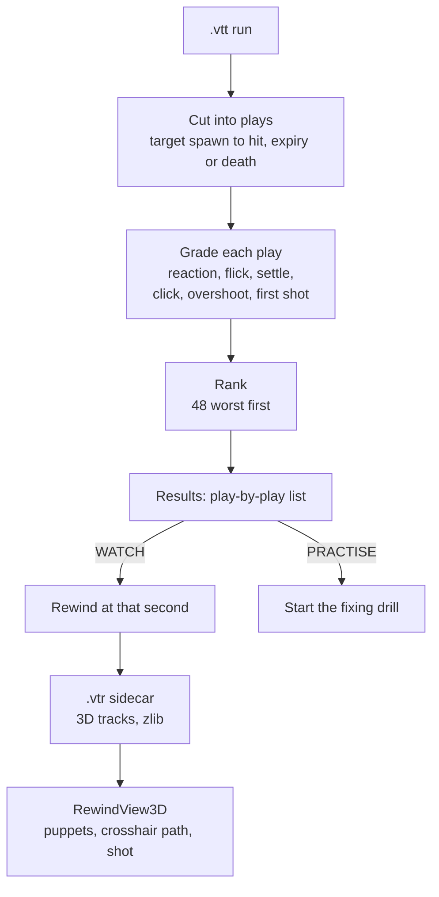

- **Rewind** rebuilds the exact moment: player and bot positions, the crosshair path, the shot that followed and the
  hit zone. Old runs without a `.vtr` still open in 2D.
- **The recording store** keeps the 20 newest runs plus up to 3 examples of every problem the coach still reports,
  deletes runs older than 30 days, and drops examples of problems that no longer appear. The index lives in
  `telemetry/recordings.json`.

---

## 12. LOCK-IN

Lock-In is a routine, not a drill: check-in, activation, calibration, mechanics, deathmatch and a hand-off. The presets
are data (`WarmupPresets.All`), so a routine is a list of steps with a phase, a cue and optional tweaks.

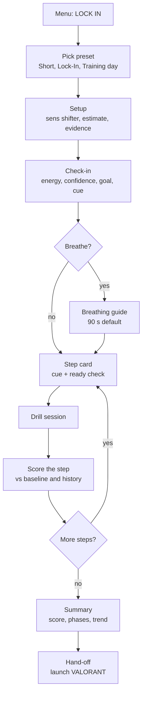

| Preset | Drills | Deathmatch | Shift |
|---|---|---|---|
| Short | 4 | 2 min | no |
| Lock-In (default) | 7 | 3 min | no |
| Training day | 12 | 5 min | optional, up to 10% |

- **Activation** runs one tier down; **calibration** adapts to roughly 80% hits; **mechanics** runs at the player's tier;
  the **deathmatch** gets easier in its last minute so the session ends on success.
- The **sens shifter** (Training day only) plays the first activation drills from +10% or −10% and steps back to the real
  sensitivity, so calibration and everything after it are played at the real value.
- **Reminders**: a soft note at 15 minutes and "you're ready, go queue" at 20.
- **Ready check** between cards offers to skip to the deathmatch when the player is already warm.

---

## 13. Agents

`AgentRoster.All` is 29 agents, each with a role, four abilities and the drills that train them. Per-agent drills take
the agent as an argument, so `flashpeek:skye` keeps its own stats, personal best and Rewind recordings.

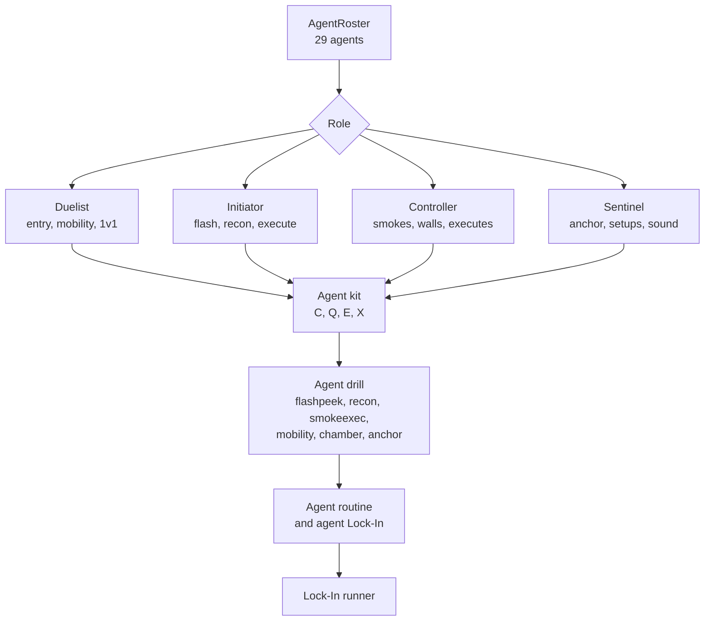

- **Drills are shared, not duplicated**: the same `FlashPeekMode` runs for Phoenix, Skye, Breach or Yoru and changes the
  flash behaviour, the timings and the cue from the agent's kit.
- **Routines** on the Agents screen chain that agent's drills into a short Lock-In (`agent:jett`).
- **Return path**: starting from the Agents screen sets `Main.ReturnToAgents`, so results and pause → menu go back
  there instead of the main menu.

---

## 14. Maps and art

The 3D drills run on true-scale single-site blockouts. When the map set is installed, the real geometry replaces them
and the official minimaps drive the menu postcards and the HUD panel.

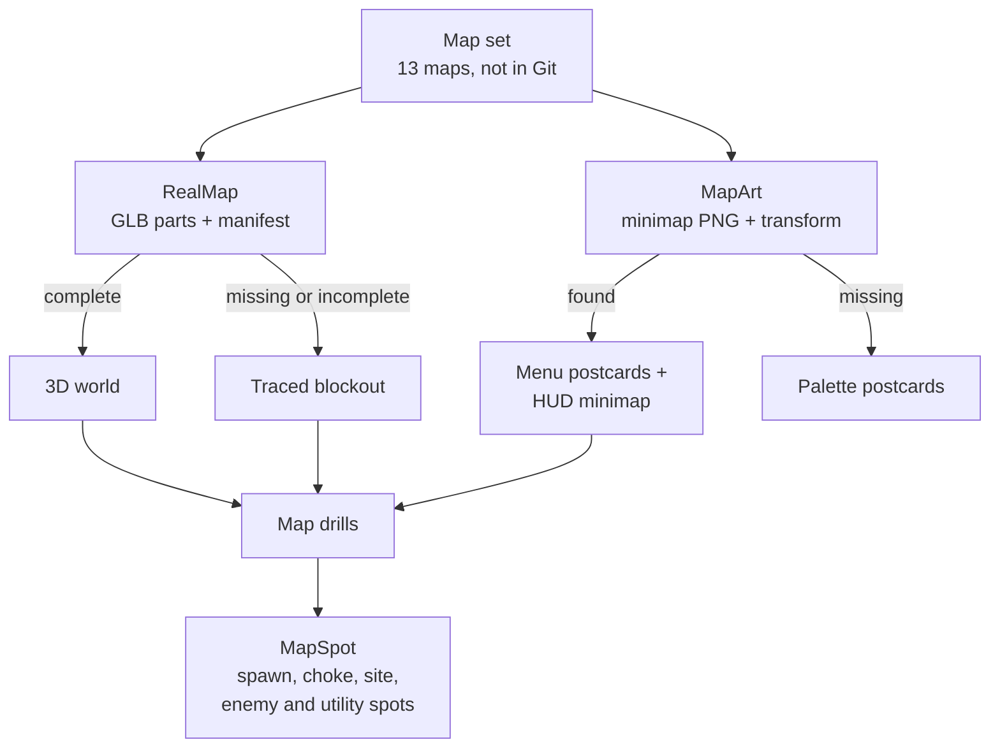

- **13 maps**: Abyss, Ascent, Bind, Breeze, Corrode, Fracture, Haven, Icebox, Lotus, Pearl, Split, Summit, Sunset.
- `RealMap` loads each part once, strips painted backdrop levels, and falls back to the blockout when a part is missing.
- `MapArt` maps world metres to minimap pixels from valorant-api's own transform; a missing PNG only costs the art, never
  a screen.
- Releases download the map set from the `maps` pre-release and stop if any of the 13 is missing.

---

## 15. Data on disk

Everything is JSON or a compact binary next to it, written atomically (`.tmp` then swap) so a crash cannot leave a
half-written file.

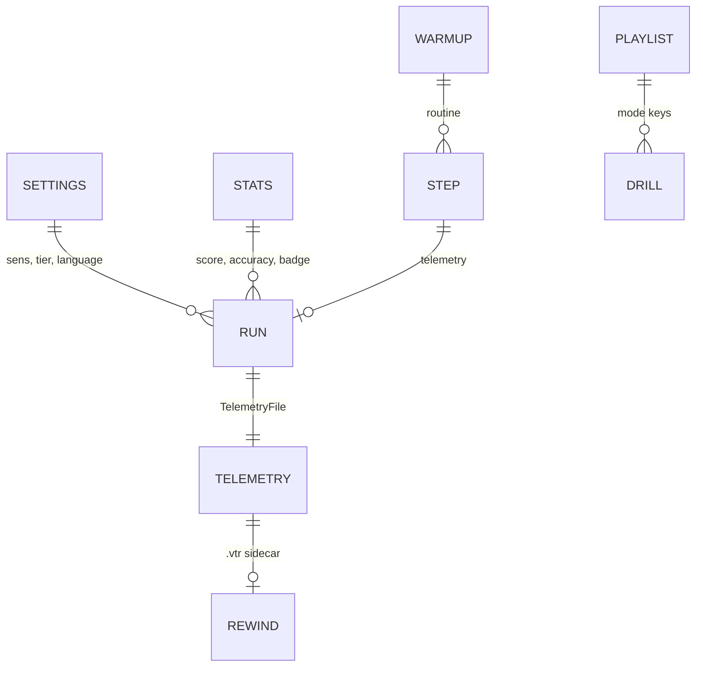

| File | Contents | Written by |
|---|---|---|
| `settings.json` | Sensitivity, crosshair, keybinds, graphics, audio, language, updates | `Core/AppSettings.cs` |
| `stats.json` | One record per finished run: score, accuracy, kills, badge, tier, map | `Core/Stats.cs` |
| `warmups.json` | Lock-In history: check-in, steps, scores, breathing, match log | `Warmup/WarmupData.cs` |
| `playlists.json` | Named sets of drill keys | `Core/Playlists.cs` |
| `telemetry/*.vtt` | Binary run: header, frames, shots, events | `Game/Telemetry.cs` |
| `telemetry/*.vtr` | 3D Rewind sidecar: tracks compressed with zlib | `Game/Replay/ReplayFile.cs` |
| `telemetry/recordings.json` | Index of which problem each kept run shows | `Game/RecordingStore.cs` |
| `%LOCALAPPDATA%/ValTrainer/updates/update.json` | Download state, target version, install kind | `Core/Updater*.cs` |
| `logs/godot.log` | The session log, rotated; a missing clean-exit line means a crash | `Core/Boot.cs` |

A corrupt file is kept as `<name>.corrupt` and the app starts fresh instead of refusing to open.

---

## 16. Language and number formatting

`Loc` is the single translation table (English and Spanish). Screens never hard-code a translated sentence.

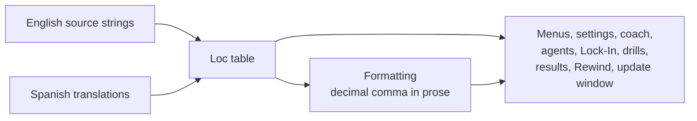

- Brand names **CA-VAL-AIM** and **LOCK-IN** are never translated.
- A sentence is left in English rather than shown half-translated.
- Spanish prose uses the decimal comma; settings, stats files and exports keep the dot. Parsers accept both.
- Changing the language rebuilds every screen on the next frame and saves the choice.

---

## 17. Updates

The check is opt-in, runs at startup and every 6 hours, and never blocks a frame.

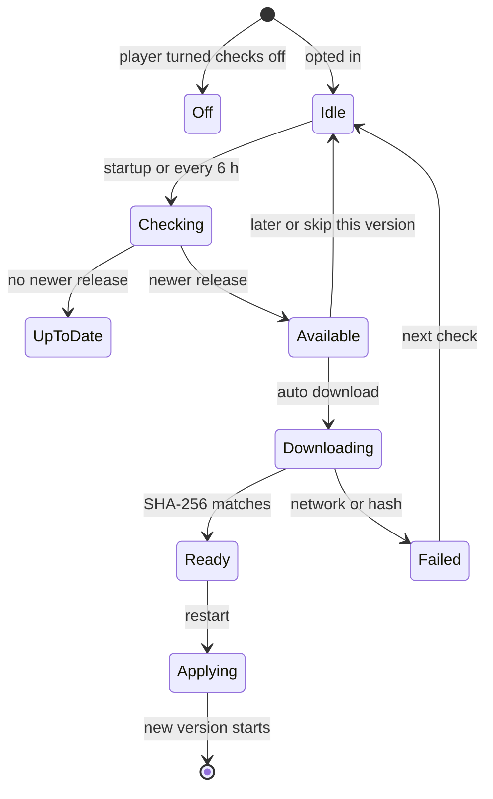

- **The installer or the portable zip** is downloaded to `%LOCALAPPDATA%\ValTrainer\updates`; the SHA-256 is checked
  against `SHA256SUMS.txt` before anything is applied.
- **Applying happens at startup**, never mid-drill. The updater writes `update.json`, shows `UpdatingScreen`, runs the
  installer in place (or swaps the portable folder) and the new version starts.
- **`SkippedVersion`** keeps a release out of the pop-up for that session while the banner stays available.
- **Nothing else goes online**: no account, no analytics, no telemetry.

---

## 18. Release pipeline

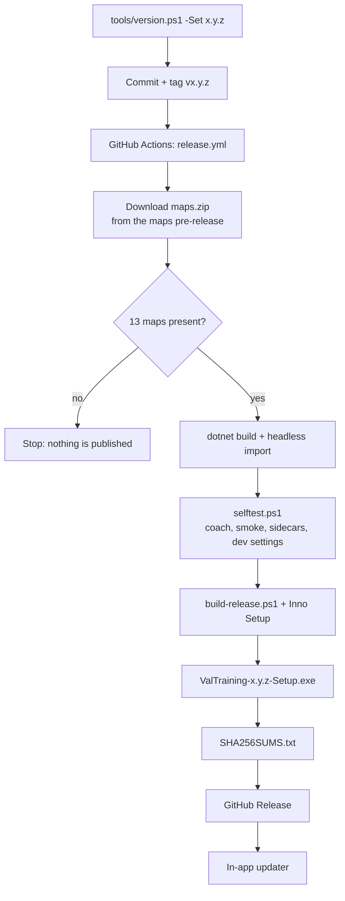

- The tag must match `config/version` in `ValTrainerGodot/project.godot`; the workflow checks it before building.
- The installer contains the app, the .NET runtime and the full map set, installs for all users in
  `C:\Program Files\CA-VAL-AIM`, and leaves `%APPDATA%\ValTrainer` untouched on upgrade.
- SignPath signs the binaries when `SIGNPATH_ORGANIZATION_ID` and `SIGNPATH_API_TOKEN` are configured; without them the
  release is built unsigned.

---

## 19. Threads and the frame loop

The game is single-threaded by design; only work that would stutter a frame leaves the main thread.

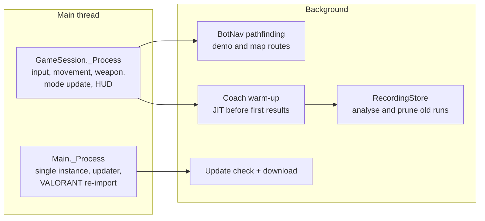

- Menus cap at 60 FPS and drills follow the player's cap (or the monitor refresh when VALORANT says "unlimited"), so an
  idle menu does not pin the GPU.
- The coach is JIT-compiled off the main thread before the first results screen, so the first review is not slow.

---

## 20. Where to look

| Concern | Files |
|---|---|
| Startup, screens, dev flags, screenshot tool | `Main.cs` |
| Settings, language, paths, single instance | `Core/AppSettings.cs`, `Loc.cs`, `Paths.cs`, `SingleInstance.cs` |
| Update check, download, install | `Core/UpdateCheck.cs`, `Updater.cs`, `UpdaterDownload.cs`, `UpdaterInstall.cs` |
| Drill registry and base class | `Modes/ModeRegistry.cs`, `Modes/TrainingMode.cs` |
| Aim library and variants | `Modes/AimModes.cs`, `AimVariants.cs`, `AimPlus*.cs` |
| Movement, recoil, utility, map drills | `Modes/Movement*.cs`, `RecoilModes.cs`, `MapModes.cs`, `Tactical*.cs` |
| Agent drills and kits | `Modes/Agents/*`, `Agents/AgentRoster.cs`, `AgentDrills.cs` |
| Session, movement, weapon, telemetry | `Game/GameSession.cs`, `MovementBody.cs`, `Weapon/WeaponController.cs`, `Telemetry.cs` |
| Bots and difficulty | `Game/Bots/*`, `Core/Difficulty.cs`, `Core/DeathmatchRules.cs` |
| Coach, metrics, play-by-play, Sens Lab | `Analysis/Coach.cs`, `RunAnalysis.cs`, `PlayByPlay.cs`, `SensLab.cs`, `LiveCoach.cs` |
| Lock-In | `Warmup/*` |
| Maps, real geometry, minimaps | `World/RealMap.cs`, `Maps/*`, `UI/MapArt.cs` |
| Rewind | `UI/RewindScreen.cs`, `RewindView3D.cs`, `Game/Replay/*` |
| Build, tests, installer | `tools/build-release.ps1`, `tools/selftest.ps1`, `installer/ValTrainer.iss` |
| CI and release | `.github/workflows/ci.yml`, `release.yml` |
